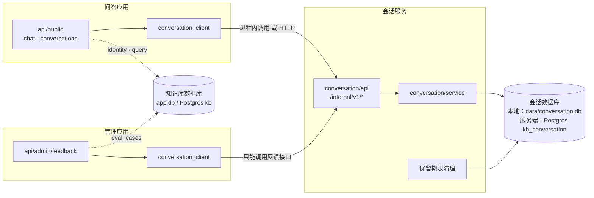
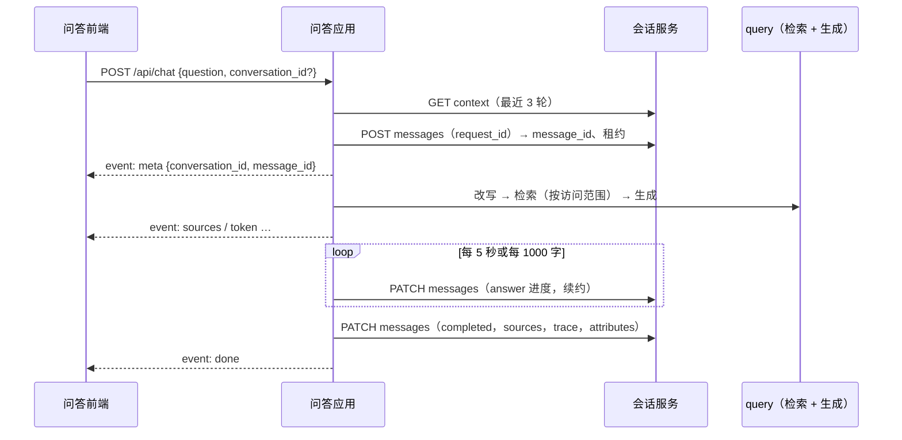

# 会话服务

- 状态：设计中（未实施）
- 对应规划：[企业知识助手演进路线 · 阶段 4](../规划/企业知识助手演进路线.md)
- 决策记录：[ADR 0015](../adr/0015-会话服务与独立数据库.md)（提议中）
- 上游方案：[对话与质量闭环](./对话与质量闭环.md)（会话的业务规则）
- 涉及模块：`conversation` `server` `api-public` `api-admin` `build`

本文中的“会话”指对话（conversation）及其中的消息，与[身份与权限](./身份与权限.md)中的登录会话（`sessions` 表）不是一回事。

## 1. 背景

阶段 4 要保存用户的多轮对话和反馈。这类数据与现有的知识库数据性质完全不同：

| 维度 | 知识库数据（文档、索引、权限、用例） | 会话数据（对话、消息、反馈） |
| --- | --- | --- |
| 所有者 | 企业，由知识管理员维护 | 提问的员工本人 |
| 写入方 | 管理应用、同步任务 | 问答应用，每次提问都写 |
| 增长 | 随文档数量缓慢增长 | 随使用量线性增长，量级高出 1–2 个数量级 |
| 敏感度 | 按文档权限控制 | 问题本身可能包含个人或业务敏感信息 |
| 谁可以看 | 知识管理员可以管理 | 只有本人；反馈经本人同意后提供给知识管理员 |
| 保留 | 长期保留，有版本历史 | 有期限（默认 180 天），用户可以随时删除 |
| 备份与恢复 | 恢复时要与向量索引保持一致 | 独立恢复，不影响知识库 |

如果放在同一个数据库中，这些差异只能靠代码约定来维持：管理端误加一个查询就能读到全部对话，保留期限清理会和知识库的写入争用同一把锁，一次备份恢复会把两类数据一起回滚。因此会话数据使用**独立的数据库**，由**独立的会话服务**负责读写，通过服务接口来保证边界。

## 2. 目标与非目标

**目标**

- 会话数据存放在独立的数据库中，与知识库数据库没有共享表、没有跨库外键、没有共享账号。
- 会话服务是唯一可以访问会话数据库的组件；问答应用和管理应用只能通过服务接口访问。
- 隐私规则由服务接口本身保证：服务**不提供**浏览他人对话的接口，管理侧只能读取用户主动提交的反馈。
- 本地模式与服务端使用同一套代码：本地在进程内运行、使用 SQLite 文件；服务端作为独立进程部署、使用独立的 Postgres 数据库。
- 会话服务故障时，问答仍然可用（降级为不保存、不带上下文），不阻塞回答。

**非目标**

- 会话服务不理解知识库：不做检索、不调用模型、不校验文档权限。
- 跨设备实时同步（多个标签页之间的推送）：刷新后从服务读取即可。
- 对话导出、对话共享。
- 独立仓库：会话服务的代码放在本仓库中，通过边界契约保证可以随时拆出去。

## 3. 服务边界

| 会话服务负责 | 会话服务不负责（由谁负责） |
| --- | --- |
| 会话的创建、列表、改名、删除 | 用户是谁（问答应用通过 `identity` 解析后传入） |
| 消息的状态流转：`streaming → completed / interrupted / failed` | 检索、改写、生成（问答应用的 `query`） |
| 同一会话同时只能有一个生成中的消息 | 来源的权限校验（问答应用读取历史后按访问范围过滤） |
| 消息附带的来源快照、检索追踪：作为不透明的 JSON 保存 | 来源快照的含义（知识库侧定义，服务只存取） |
| 反馈的提交、修改、撤回；反馈快照；反馈处理状态 | 反馈转为回归用例（管理应用，用例存在知识库数据库中） |
| 保留期限清理、按用户删除全部数据 | 用户离职的判断（`identity` 发现后通知会话服务） |
| 服务间调用的认证与授权 | 终端用户登录（`identity`） |

**原则**：会话服务对知识库一无所知。来源快照中的 `doc_id`、检索追踪中的 `chunk_id` 对它来说只是字符串。知识库侧的结构变化不需要修改会话服务，会话服务也就可以独立演进和部署。

## 4. 架构与部署形态



| 运行方式 | 会话服务 | 会话数据库 | 调用方式 |
| --- | --- | --- | --- |
| 本地默认（`kb-studio`） | 与问答、管理应用在同一进程 | `data/conversation.db`（独立的 SQLite 文件） | 进程内直接调用服务层，跳过 HTTP，但经过同一套授权检查 |
| 分进程 / 服务端 | 独立进程 `kb-studio-conversation`，默认端口 `8767`，只在内网监听 | 独立的 Postgres 数据库 `kb_conversation`，独立账号 | HTTP，服务令牌认证 |

用 `KB_CONVERSATION_MODE=embedded | remote` 切换。这与 ADR 0007 的做法一致：本地同进程运行，部署时拆开，代码不变。

## 5. 代码结构与边界契约

```text
backend/src/kb_studio/
  conversation/                会话服务：除自身外只允许依赖 settings
    settings.py                服务自己的配置（数据库地址、保留期限、令牌）
    db/
      connection.py            独立的连接与迁移，不复用 kb_studio.db
      migrations.py            独立的迁移序列
      conversations_repo.py  messages_repo.py  feedback_repo.py
    service.py                 业务规则：状态流转、并发生成检查、删除级联
    feedback.py                反馈与快照、处理状态
    retention.py               保留期限清理、按用户删除
    auth.py                    调用方令牌与权限范围
    api.py                     /internal/v1/* 路由
  conversation_client/         调用方 SDK：问答和管理应用只依赖这里
    protocol.py                ConversationClient 协议与数据类型
    embedded.py                进程内实现（调用 conversation.service）
    http.py                    HTTP 实现（httpx，超时与重试）
  apps/conversation_app.py     会话服务的应用入口
```

import-linter 契约（新增）：

| 契约 | 内容 |
| --- | --- |
| 会话服务独立 | `kb_studio.conversation` 不得依赖 `kb_studio` 中除 `settings` 以外的任何模块（`db`、`query`、`identity`、`rag`、`ingest`、`auth`、`api`、`apps` 等） |
| 会话数据只经由客户端访问 | `kb_studio.api`、`kb_studio.evaluation`、`kb_studio.ingest` 不得直接依赖 `kb_studio.conversation`（含间接依赖），只能依赖 `conversation_client` |
| 客户端不含业务 | `conversation_client` 只能依赖 `conversation` 的 `service` 和数据类型（embedded 实现需要），不得依赖 `kb_studio.db` 等知识库模块 |
| 应用入口独立 | `apps.conversation_app` 与 `apps.chat_app`、`apps.admin_app` 互相独立 |

第二条契约允许 `api.public` 经由 `conversation_client.embedded` 间接依赖 `conversation`，实现上用 import-linter 的 `ignore_imports` 只放行 `conversation_client.embedded → conversation.service` 这一条边。

## 6. 数据模型

会话数据库有自己的迁移序列（本地用 `PRAGMA user_version`，迁移到服务端后与知识库一样改用 Alembic，但使用独立的版本链）。

```sql
CREATE TABLE conversations (
    id          TEXT PRIMARY KEY,            -- UUIDv7：可以跨库引用，不暴露数量
    user_key    TEXT NOT NULL,               -- 用户标识，见下文
    title       TEXT NOT NULL,
    created_at  TEXT NOT NULL,
    updated_at  TEXT NOT NULL,
    deleted_at  TEXT                         -- 删除后立即不可见，清理任务物理删除
);
CREATE INDEX idx_conversations_user ON conversations(user_key, updated_at);

CREATE TABLE messages (
    id               TEXT PRIMARY KEY,       -- UUIDv7
    conversation_id  TEXT NOT NULL REFERENCES conversations(id) ON DELETE CASCADE,
    request_id       TEXT NOT NULL UNIQUE,   -- 调用方生成，重试时保证幂等
    question         TEXT NOT NULL,
    rewritten_query  TEXT,
    answer           TEXT NOT NULL DEFAULT '',
    status           TEXT NOT NULL,          -- streaming / completed / interrupted / failed
    error_code       TEXT,
    sources          TEXT NOT NULL DEFAULT '[]',   -- 不透明 JSON，不含片段正文
    trace            TEXT,                         -- 不透明 JSON，不含片段正文
    attributes       TEXT NOT NULL DEFAULT '{}',   -- 索引版本、模型、耗时等，不透明 JSON
    regenerated_from TEXT REFERENCES messages(id),
    lease_until      TEXT,                   -- 生成中的租约，过期视为中断
    created_at       TEXT NOT NULL,
    updated_at       TEXT NOT NULL
);
CREATE INDEX idx_messages_conversation ON messages(conversation_id, created_at);

CREATE TABLE feedback (
    id          TEXT PRIMARY KEY,
    message_id  TEXT REFERENCES messages(id) ON DELETE SET NULL,
    user_key    TEXT NOT NULL,
    rating      TEXT NOT NULL,               -- up / down
    reasons     TEXT NOT NULL DEFAULT '[]',
    comment     TEXT,
    snapshot    TEXT NOT NULL,               -- 提交时的该轮问答快照，见对话与质量闭环 4.2
    status      TEXT NOT NULL DEFAULT 'open',-- open / triaged / converted / dismissed
    assignee    TEXT,                        -- 处理人的 user_key
    note        TEXT,
    linked_ref  TEXT,                        -- 转换后的回归用例引用，如 eval_case:42
    created_at  TEXT NOT NULL,
    updated_at  TEXT NOT NULL,
    UNIQUE (message_id, user_key)
);
CREATE INDEX idx_feedback_status ON feedback(status, created_at);
```

**跨库引用规则**

| 字段 | 引用 | 约束方式 |
| --- | --- | --- |
| `user_key` | 知识库侧的用户 | 取 `<provider>:<subject>`（如 `feishu:ou_xxx`、`local:local`），不使用知识库数据库的自增 ID，两个库可以独立重建 |
| `sources`、`trace`、`attributes` 中的 `doc_id`、`index_id` | 知识库侧的文档与索引 | 不建外键；读取时由问答应用校验，读不到的显示为“已不存在” |
| `linked_ref` | 知识库侧的回归用例 | 不建外键；回归用例上反向保存 `source_feedback_id` |

- ID 使用 UUIDv7：按时间有序，便于分页；跨库引用时不会冲突；不像自增 ID 那样暴露对话数量。
- `request_id` 由问答应用为每次提问生成，网络重试不会产生重复消息。
- `lease_until` 用来识别“生成到一半进程崩溃”的消息：问答应用每次保存进度时续约，过期的 `streaming` 消息由服务自动改为 `interrupted`，不依赖调用方重启时清理。

## 7. 内部接口

所有路径以 `/internal/v1` 开头，只在内网监听，不经过对外的负载均衡。

| 方法与路径 | 调用方权限范围 | 说明 |
| --- | --- | --- |
| `POST /conversations` | `chat` | 新建会话 |
| `GET /conversations?user_key=&cursor=` | `chat` | 某用户的会话列表 |
| `PATCH /conversations/{id}` · `DELETE /conversations/{id}` | `chat` | 改名 · 删除 |
| `DELETE /users/{user_key}/conversations` | `chat` | 清空该用户全部会话 |
| `GET /conversations/{id}/messages?before=` | `chat` | 消息分页 |
| `GET /conversations/{id}/context?turns=3` | `chat` | 最近几轮问答，供改写和生成使用 |
| `POST /conversations/{id}/messages` | `chat` | 开始一次回答：创建 `streaming` 消息并取得租约；会话中已有生成中的消息时返回 409 |
| `PATCH /messages/{id}` | `chat` | 保存进度并续约；或结束为 `completed` / `interrupted` / `failed` |
| `PUT /messages/{id}/feedback` · `DELETE` | `chat` | 提交或修改反馈 · 撤回 |
| `GET /feedback` · `GET /feedback/{id}` | `feedback:read` | 反馈列表与详情（只含快照，不能顺着反馈读取会话的其他消息） |
| `PATCH /feedback/{id}` | `feedback:write` | 处理状态、处理人、说明、`linked_ref` |
| `GET /feedback/stats` | `feedback:read` | 按原因、日期、文档（快照中的 `doc_id`）聚合 |
| `DELETE /users/{user_key}` | `user:purge` | 删除该用户的全部会话；反馈保留快照但去除 `user_key` 关联 |
| `GET /policy` | `chat` | 历史可见性策略（10.1） |
| `GET /healthz` · `/readyz` | 无 | 健康检查 |

约定：

- **带用户的操作都必须传 `user_key`，服务校验资源属于该用户**；不属于时返回 404，不暴露资源是否存在。服务信任调用方传入的 `user_key`，因为只有持有 `chat` 令牌的问答应用能调用这些接口，而问答应用的 `user_key` 来自已验证的登录会话。
- 没有“按会话 ID 读取任意用户会话”的管理接口。这是隐私承诺在接口层面的体现：管理应用即使被攻破，也只能读到反馈快照。
- 错误格式统一为 `{code, message}`；分页统一使用游标。
- 接口带版本号，破坏性变更通过 `/internal/v2` 并行提供，调用方切换后再下线旧版本。

## 8. 服务间认证与授权

| 调用方 | 令牌 | 权限范围 |
| --- | --- | --- |
| 问答应用 | `KB_CONVERSATION_TOKEN_CHAT` | `chat` |
| 管理应用 | `KB_CONVERSATION_TOKEN_ADMIN` | `feedback:read`、`feedback:write` |
| 身份同步任务（worker） | `KB_CONVERSATION_TOKEN_WORKER` | `user:purge` |

- 服务端只保存令牌的 SHA-256。两个令牌同时有效以支持轮换：先下发新令牌，所有调用方切换后再撤销旧令牌。
- 令牌通过 `Authorization: Bearer` 传递；网络层只允许应用区访问 `8767` 端口；有条件时使用 mTLS 替代令牌。
- 进程内模式不走 HTTP，但 `embedded` 客户端在构造时声明自己的权限范围，经过同一个授权函数，保证本地模式下管理应用同样读不到会话。
- 每次调用记录调用方、接口、`user_key` 的哈希、结果，不记录问题和回答原文。

## 9. 问答流程中的调用



**降级策略**：会话服务的可用性不能成为问答的单点。

| 故障时机 | 行为 |
| --- | --- |
| 读取上下文失败 | 按单轮问答继续，`meta` 中带 `context: false` |
| 创建消息失败 | 继续回答，但不保存；`meta` 中带 `persisted: false`，前端提示“本次回答未保存” |
| 保存进度失败 | 继续回答，最后一次保存时一并写入 |
| 结束保存失败 | 重试 3 次（100ms、500ms、2s）；仍然失败时记录日志，消息由租约过期变为 `interrupted`，保留最后一次进度 |
| 读取历史失败 | 会话列表显示错误，可以重试；不影响新的提问 |

调用超时：读操作 1 秒，写操作 2 秒。`http` 客户端使用连接池，熔断阈值为 10 秒内失败率超过 50%，熔断期间直接走降级路径，30 秒后半开探测。

## 10. 隐私与数据治理

### 10.1 历史可见性策略

主流企业知识助手默认向**用户本人**展示自己的对话历史，同时提供组织级开关；强监管行业常要求关闭历史或不落盘。这里做成部署级策略 `KB_CONVERSATION_HISTORY`：

| 取值 | 用户能否看到历史 | 是否保存到会话数据库 | 多轮追问 | 反馈 | 适用 |
| --- | --- | --- | --- | --- | --- |
| `enabled`（默认） | 能，本人可见，可以删除 | 保存，按保留期限清理 | 支持 | 支持 | 一般企业 |
| `session_only` | 只在当前页面可见，刷新即消失 | 只保存当前会话，`KB_CONVERSATION_EPHEMERAL_HOURS`（默认 24 小时）后物理删除，不出现在会话列表中 | 支持 | 支持，快照照常保存 | 对历史留存敏感的企业 |
| `disabled` | 不能 | 不保存，会话服务不写入任何消息 | 不支持，每次都是单轮 | 不支持 | 强监管、要求零留存 |

- 无论哪种策略，**管理员都不能浏览用户的对话**，只能读取用户主动提交的反馈。
- 策略由会话服务执行，问答应用通过 `GET /internal/v1/policy` 读取策略来决定是否显示会话列表，前端不自行判断。
- 切换为更严格的策略时，已有数据按新策略的保留期限清理；切换为更宽松的策略时，不会恢复已经删除的数据。

### 10.2 数据治理


| 要求 | 实现 |
| --- | --- |
| 管理员不能浏览对话 | 服务不提供这类接口；管理应用的令牌只有反馈权限 |
| 反馈即同意 | 反馈快照只包含被反馈的那一轮；提交前界面明确提示 |
| 用户删除 | 删除后立即不可见（`deleted_at`），清理任务在 24 小时内物理删除 |
| 保留期限 | 服务内置每日任务，物理删除超过 `KB_CONVERSATION_RETENTION_DAYS`（默认 180 天）未更新的会话 |
| 用户离职 | `identity` 发现用户停用后，提交一个延迟 30 天的 `purge_user_conversations` 任务，到期调用 `DELETE /users/{user_key}`；30 天的缓冲期用于误停用后恢复 |
| 受限内容不留副本 | 来源快照只存 `doc_id`、版本、章节、分数，不存片段正文 |
| 存储加密 | 服务端数据库开启存储加密；备份文件加密 |
| 日志 | 服务日志不记录问题和回答原文 |

## 11. 部署与运维

| 配置 | 说明 |
| --- | --- |
| `KB_CONVERSATION_MODE` | `embedded`（默认）/ `remote` |
| `KB_CONVERSATION_DB_URL` | 默认 `sqlite:///<KB_DATA_DIR>/conversation.db`；服务端为独立的 Postgres 数据库 |
| `KB_CONVERSATION_URL` | `remote` 模式下问答、管理应用访问会话服务的地址 |
| `KB_CONVERSATION_HOST`、`KB_CONVERSATION_PORT` | 会话服务监听地址，默认 `127.0.0.1:8767` |
| `KB_CONVERSATION_TOKEN_*` | 第 8 节的令牌，只放在 `backend/.env` 或密钥管理服务中 |
| `KB_CONVERSATION_RETENTION_DAYS` | 保留期限 |
| `KB_CONVERSATION_HISTORY` | 历史可见性策略，见 10.1 |
| `KB_CONVERSATION_EPHEMERAL_HOURS` | `session_only` 策略下的保存时长 |

- **数据库**：服务端使用独立的 Postgres 数据库 `kb_conversation`。可以与知识库数据库在同一个实例上（降低运维成本），但账号、权限、备份策略分开；数据量或隐私要求提高时迁移到独立实例，只需修改连接地址。
- **扩展**：服务无状态，可以多实例部署；并发生成的检查依赖数据库中的租约，不依赖进程内状态。
- **备份**：独立的备份策略。RPO 可以放宽到 1 小时；恢复会话数据库不影响知识库，反之亦然。
- **指标**：各接口的 QPS、延迟、错误率；生成中的消息数；租约过期数；清理删除量；降级次数（由问答应用上报）。
- **本地数据目录**：`data/conversation.db` 与 `data/app.db` 并列。删除前者只会清空对话记录，知识库不受影响。

## 12. 测试与验证

**单元测试**（服务层用临时 SQLite 文件，不读写 `data/`）

| 对象 | 覆盖内容 |
| --- | --- |
| 边界 | import-linter 契约；`conversation` 包中不出现任何 `kb_studio.db` 引用 |
| 归属 | 访问他人的会话、消息、反馈都返回 404 |
| 授权 | 管理令牌调用会话接口返回 403；`embedded` 模式下同样生效 |
| 状态流转 | 并发生成返回 409；租约过期自动变为 `interrupted`；`request_id` 幂等 |
| 删除 | 软删除后不可见；物理删除级联；反馈快照保留并去除关联 |
| 保留期限 | 过期会话被清理，未过期的保留 |
| 客户端 | `embedded` 与 `http` 实现通过同一组契约测试；超时、重试、熔断 |
| 降级 | 会话服务不可用时问答仍然返回完整回答，`meta` 标记正确 |

**端到端验证**（隔离的数据目录和端口，例如 `KB_CONVERSATION_PORT=18767`）

1. `remote` 模式启动四个进程（问答、管理、会话服务、worker），完成多轮对话、反馈、转为用例的完整流程。
2. 停掉会话服务，确认问答仍然可用并提示未保存；恢复后新的对话正常保存。
3. 用管理令牌尝试读取会话接口，确认被拒绝。

## 13. 实施顺序与待确认事项

| 步骤 | 内容 | 可单独验收 |
| --- | --- | --- |
| 1 | `conversation` 包骨架、独立数据库与迁移、服务层、边界契约；`embedded` 客户端 | 契约测试通过；`data/conversation.db` 独立生成 |
| 2 | 问答应用接入：会话列表、消息保存、上下文、降级 | 本地模式下刷新后可以回看对话 |
| 3 | 反馈接口与管理应用的反馈页面 | 反馈闭环演示 |
| 4 | `conversation_app`、HTTP 接口、服务令牌、`http` 客户端 | `remote` 模式端到端验证通过 |
| 5 | 保留期限、用户离职清理、指标 | 清理任务生效 |

步骤 1–3 不依赖阶段 2 的飞书登录：本地模式下 `user_key` 固定为 `local:local`，接入登录后自动变为真实用户。步骤 1 可以在阶段 1 实施期间并行开始。

待确认事项：

| 事项 | 建议 | 说明 |
| --- | --- | --- |
| 反馈存放在会话数据库还是知识库数据库 | 会话数据库 | 反馈是用户产生的数据，快照包含问题原文；管理应用通过反馈接口读取 |
| 服务端是否与知识库共用 Postgres 实例 | 共用实例、独立数据库和账号 | 运维成本低；隐私要求提高时改为独立实例 |
| 本地模式是否也拆成独立进程 | 不拆，进程内运行 | 与 ADR 0007 一致；需要时设置 `KB_CONVERSATION_MODE=remote` |
| 用户离职后的缓冲期 | 30 天 | 需要与公司数据政策核对 |
| 历史可见性默认策略 | `enabled`：用户本人可见、可删除，管理员不可见 | 强监管场景改为 `session_only` 或 `disabled` |
