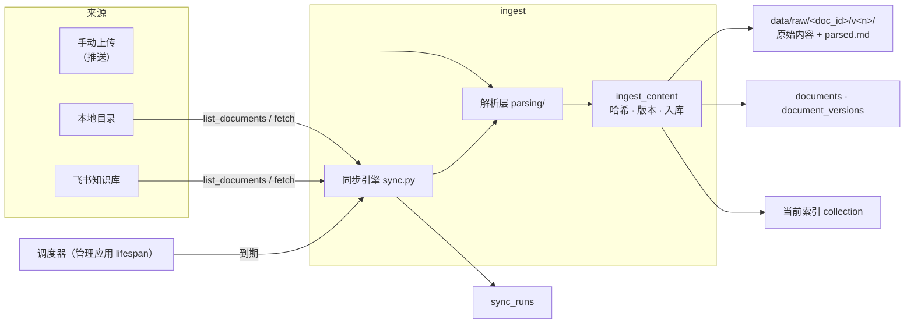
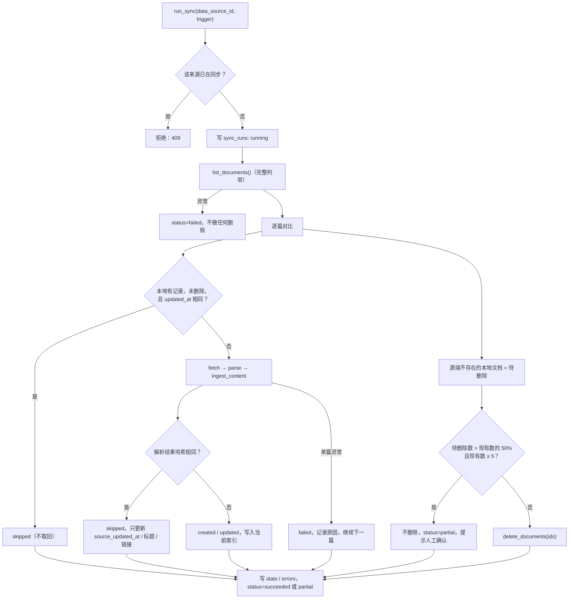

# 多数据源接入

- 状态：设计中（未实施）
- 对应规划：[企业知识助手演进路线 · 阶段 1](../规划/企业知识助手演进路线.md)
- 决策记录：[ADR 0009](../adr/0009-连接器抽象与文档身份规则.md)
- 涉及模块：`ingest` `db` `storage` `query` `api-admin` `api-public` `web-admin` `web-chat` `server`

## 1. 背景

现有入库链路是“后台上传 → 按文件名识别 → 哈希判断 → 按 `doc_id` 替换块”，只支持手动上传的 `.md` / `.txt`。阶段 1 的目标是让知识可以从企业文档平台自动同步，第一个外部来源是飞书。

现有实现中与数据源相关的约束：

| 位置 | 现状 | 阶段 1 要改的地方 |
| --- | --- | --- |
| `documents.filename` | `UNIQUE`，即文档身份 | 身份改为 `(data_source_id, source_id)` |
| `ingest/incremental.upload_document` | 校验、哈希、存原文件、入库写在一起 | 拆出与来源无关的 `ingest_content` |
| `storage/raw_store.read_text` | 入库和重建都直接按 UTF-8 读原文件 | 改为读解析结果 `parsed.md` |
| `rag/splitter.build_chunks` | 元数据 `source` 取文件名 | 改取 `title`，其余不变 |
| `rag/qa.to_source` | 来源只有文件名和章节 | 增加 `source_url` |
| 后台任务 | FastAPI `BackgroundTasks` | 增加定时同步的调度器 |

## 2. 目标与非目标

**目标**

- 连接器抽象：新增来源只需实现一个连接器，不改入库链路。
- 手动上传纳入同一抽象，现有数据平滑迁移，不需要重建索引，回归结果不变。
- 支持手动触发同步和定时同步；源端新增、修改、删除都能反映到当前索引。
- 每次同步可追溯：什么时候、新增 / 更新 / 跳过 / 删除 / 失败各多少，失败原因是什么。
- 回答来源可以跳回源系统原文。

**非目标**

- 权限过滤：属于阶段 2。本阶段同步进来的内容对所有问答用户可见，所以只能接入测试空间。
- webhook 实时同步：飞书事件订阅需要公网回调地址，本地部署接收不到，先用轮询。
- 迁移数据库或引入任务队列：继续使用 SQLite、Chroma 和进程内调度（见规划第 4 节）。
- 飞书电子表格、多维表格、旧版文档（`doc`）：首期只同步新版文档 `docx`，其他类型计为“不支持”并在同步记录中列出。

## 3. 整体结构



代码位置（全部在写入链路 `ingest` 内，问答端依然不可依赖，import-linter 契约不用改）：

```
backend/src/kb_studio/
  ingest/
    connectors/
      base.py          Connector 协议、SourceRef、SourcePayload、错误类型
      registry.py      source_type → 连接器类
      upload.py        手动上传（推送模式）
      local_dir.py     本地目录
      feishu/
        client.py      tenant_access_token、分页、频控重试
        wiki.py        知识空间节点遍历
        blocks.py      docx blocks → Markdown
        connector.py
    parsing/
      __init__.py      parse(payload) → ParsedDocument，按 MIME / 后缀分发
      text.py          .md / .txt
    sync.py            同步引擎：对比、入库、删除保护、记录
    scheduler.py       定时同步的轮询线程
    incremental.py     ingest_content（由 upload_document 拆出）
  db/
    migrations.py      PRAGMA user_version 驱动的迁移
    data_sources_repo.py
    sync_runs_repo.py
  api/admin/
    sources.py         数据源管理与同步接口
```

## 4. 连接器接口

```python
@dataclass(frozen=True)
class SourceRef:
    source_id: str                  # 源系统里的稳定 ID，改名、移动后不变
    title: str
    url: str | None
    updated_at: str | None          # 源端更新时间，用于跳过未变化的文档；拿不到时为 None
    kind: str                       # docx / md / txt …，不支持的类型也要列出，由引擎计为 unsupported


@dataclass(frozen=True)
class SourcePayload:
    ref: SourceRef
    content: bytes                  # 原样存入 raw，不做任何转换
    media_type: str                 # 交给解析层分发


class Connector(Protocol):
    source_type: ClassVar[str]

    def __init__(self, config: dict) -> None: ...
    def test(self) -> None: ...                         # 配置与凭证校验，失败时抛 ConnectorError
    def list_documents(self) -> Iterator[SourceRef]: ...
    def fetch(self, ref: SourceRef) -> SourcePayload: ...
```

约定：

- `list_documents` 必须完整列举，或者抛出异常；不允许静默返回部分结果。删除判断依赖这一点。
- `fetch` 只取一篇。失败时抛 `ConnectorError`，引擎把这篇记为失败，继续处理下一篇。
- 连接器不访问数据库和向量库，不知道 `doc_id` 是什么，可以离线单测。
- 规划中的 `changed_since(ts)` 不作为必需接口。飞书知识空间节点自带编辑时间，全量列举加时间对比的成本已经很低，而“删除”只能通过全量列举发现。某个来源以后有增量接口时，再作为可选的优化接口加上。
- 源端权限信息（阶段 2 用）先不进接口，到阶段 2 再给 `SourceRef` 增加字段，不影响已有连接器。

## 5. 解析层

```python
@dataclass(frozen=True)
class ParsedDocument:
    markdown: str
    warnings: list[str]   # 例如“跳过 3 张图片”“表格合并单元格已展开”
```

| 来源 / 格式 | 解析器 | 说明 |
| --- | --- | --- |
| `.md` / `.txt` | `text.py` | 原样返回（只去掉 BOM）；保证哈希与迁移前一致 |
| 飞书 `docx` | `feishu/blocks.py` | 由连接器先转好 Markdown，以 `text/markdown` 交给解析层 |
| `.docx` `.pdf` `.pptx` `.xlsx` `.html` | 后续接入 markitdown | 不在本方案首期范围，解析层只预留分发入口 |

内容哈希对 `parsed.markdown.encode("utf-8")` 计算，即“影响索引的内容”的哈希。解析器升级导致输出变化时，相关文档会被正常识别为新版本并重新入库，这是预期行为。

## 6. 数据模型

### 6.1 新表

```sql
CREATE TABLE data_sources (
    id               INTEGER PRIMARY KEY AUTOINCREMENT,
    source_type      TEXT NOT NULL,           -- upload / local_dir / feishu_wiki
    name             TEXT NOT NULL,
    config           TEXT NOT NULL,           -- JSON，不含任何密钥
    enabled          INTEGER NOT NULL DEFAULT 1,
    sync_interval_min INTEGER,                -- NULL 表示只手动同步
    last_sync_at     TEXT,
    created_at       TEXT NOT NULL
);

CREATE TABLE sync_runs (
    id             INTEGER PRIMARY KEY AUTOINCREMENT,
    data_source_id INTEGER NOT NULL REFERENCES data_sources(id),
    trigger        TEXT NOT NULL,             -- manual / schedule
    status         TEXT NOT NULL,             -- running / succeeded / partial / failed / interrupted
    stats          TEXT NOT NULL DEFAULT '{}',-- {created, updated, skipped, deleted, failed, unsupported}
    errors         TEXT NOT NULL DEFAULT '[]',-- [{source_id, title, error}]，最多保留 50 条
    started_at     TEXT NOT NULL,
    finished_at    TEXT
);
```

- 迁移时插入一行内置数据源 `id=1, source_type=upload, name=手动上传`，不可删除、不可停用。
- 密钥不进数据库：飞书 `FEISHU_APP_ID`、`FEISHU_APP_SECRET` 与现有模型密钥一样放在 `backend/.env`。`config` 只放空间 ID、域名等非敏感信息，接口返回时可以原样输出。

### 6.2 `documents` 重建

SQLite 无法删除列上的 `UNIQUE` 约束，只能按官方推荐的步骤重建表：建新表 → 复制数据 → 删除旧表 → 改名，全程在一个事务内完成，期间关闭外键检查。

```sql
CREATE TABLE documents (
    id                INTEGER PRIMARY KEY AUTOINCREMENT,
    data_source_id    INTEGER NOT NULL REFERENCES data_sources(id),
    source_id         TEXT NOT NULL,
    title             TEXT NOT NULL,
    source_url        TEXT,
    source_updated_at TEXT,
    current_version   INTEGER NOT NULL,
    content_hash      TEXT NOT NULL,
    status            TEXT NOT NULL,
    chunk_count       INTEGER NOT NULL DEFAULT 0,
    error             TEXT,
    updated_at        TEXT NOT NULL,
    UNIQUE (data_source_id, source_id)
);
```

`document_versions` 增加两列，都允许为空，旧数据不回填：

| 列 | 含义 |
| --- | --- |
| `parsed_path` | 解析结果 `parsed.md` 的路径；为空时回退为按 UTF-8 读 `raw_path`（迁移前的版本） |
| `source_updated_at` | 该版本对应的源端更新时间 |

### 6.3 迁移步骤

现有 `init_db()` 只执行 `CREATE TABLE IF NOT EXISTS`，没有版本概念。新增 `db/migrations.py`：

1. 读取 `PRAGMA user_version`。现有库为 0，新库直接建最新结构并写入最新版本号。
2. 需要迁移时，先把 `app.db` 复制为 `app.db.bak-<时间戳>`，失败就中止启动。
3. 迁移 1：
   - 建 `data_sources`、`sync_runs`，插入内置上传来源。
   - 重建 `documents`：`data_source_id=1`、`source_id=filename`、`title=filename`。
   - 给 `document_versions` 加列。
   - 写入 `user_version=1`。
4. 迁移和建表都在 `lifespan` 中执行，问答和管理两个应用谁先启动谁执行。迁移本身是幂等的，用 `BEGIN IMMEDIATE` 保证同一时刻只有一个进程在迁移。

Chroma 不用迁移：块元数据里的 `doc_id`、`version`、`source`（标题）、`section` 都保持原样，`source_url` 在检索时补齐（见 10.2），所以已有索引版本可以继续使用，蓝绿切换不受影响。

## 7. 同步引擎

### 7.1 流程



要点：

- **复用现有入库函数**：`ingest_content(data_source_id, ref, raw, parsed)` 由 `upload_document` 拆出，内部仍是 `decide_action` → 存版本 → `index_document`。上传接口变成 `upload` 连接器的一层薄封装，现有行为不变。
- **标题、链接变化不产生新版本**：只更新 `documents` 上的字段。下次重新入库时，块元数据里的标题随之更新；在这之前，回答来源里的标题在检索时按 `doc_id` 补齐，始终是最新的。
- **只写当前索引**：与现有增量入库一致，其他索引版本是快照。同步期间如果正在重建索引，新索引里会缺少这次同步的变化，切换后这些文档会显示为“待同步”（现有 `sync_documents_with_index` 已能识别），重新同步或重新入库即可补齐。
- **删除是软删除**，复用 `delete_documents`。源端恢复后，下次同步按“已删除文档重新出现”处理为新版本（现有 `decide_action` 的行为）。
- **数据源被删除或停用**：删除时软删除该来源的全部文档，`data_sources` 行保留并标记为停用，保证同步记录可追溯。

### 7.2 并发与中断

- 同一来源同一时刻只允许一个同步：进程内 `threading.Lock` 字典，加上 `sync_runs` 中 `running` 状态的检查（防止两个入口同时触发）。
- 后端重启时，把残留的 `running` 记录改为 `interrupted`。同步是幂等的，下次重跑会从头对比，已入库的文档会被跳过。
- 手动上传与同步写的是不同来源的文档，不会冲突；共同写入的只有 `refresh_counts`，它按 collection 的实际内容重算，不存在丢失更新。

### 7.3 调度器

- 在管理应用的 `lifespan` 中启动一个守护线程，每 60 秒检查一次：启用的、配置了间隔的、`last_sync_at + 间隔 ≤ 现在` 且没在同步中的来源，依次执行 `run_sync(…, "schedule")`。
- 只在管理应用中运行，问答应用不启动调度器。分进程部署时管理应用只能部署一个实例，否则会重复调度；这一点写入部署说明，到规划第 4 节换成任务队列时再解决。
- 最小同步间隔 15 分钟，避免误配置导致频控和费用问题。

### 7.4 费用与频控

- 第一次同步一个大空间会触发大量 Embedding 调用。同步前在后台展示“预计文档数”（来自 `test` 接口的列举结果），由人确认后再启动。
- Embedding 沿用现有批量参数（`chunk_size=10`），不额外并发。

## 8. 飞书连接器

### 8.1 授权方式

| 方式 | 适用 | 结论 |
| --- | --- | --- |
| 自建应用 + `tenant_access_token` | 服务端定时任务，不依赖某个人的登录状态 | **阶段 1 采用** |
| 用户 OAuth + `user_access_token` | 以某个用户的视角读取，能拿到用户身份 | 放到阶段 2，与问答端登录一起设计 |

规划中写的是“完成 OAuth 授权”。这里调整为阶段 1 先用应用凭证，理由是：

- 同步是后台任务，用户 token 会过期，refresh token 也有有效期，任何一次失效都会让定时同步中断。
- 用户 OAuth 的价值在于身份和权限，这正是阶段 2 的内容。

使用前要在飞书开放平台创建企业自建应用，开通知识库和云文档的只读权限，并把应用添加为目标知识空间的成员。**这一调整需要确认，见第 12 节。**

### 8.2 列举与取回

| 步骤 | 接口 | 说明 |
| --- | --- | --- |
| 获取凭证 | `POST /open-apis/auth/v3/tenant_access_token/internal` | 按返回的有效期缓存，提前 5 分钟刷新 |
| 列举节点 | `GET /open-apis/wiki/v2/spaces/:space_id/nodes` | 按 `parent_node_token` 递归，分页拉完；节点提供 `node_token`、`obj_token`、`obj_type`、`title`、`obj_edit_time` |
| 取回正文 | `GET /open-apis/docx/v1/documents/:document_id/blocks` | 分页拉取全部 block，`document_id` 即节点的 `obj_token` |

映射到 `SourceRef`：

| 字段 | 取值 |
| --- | --- |
| `source_id` | `node_token`（节点在知识空间内移动后不变） |
| `title` | 节点 `title` |
| `url` | `https://<域名>/wiki/<node_token>`，域名在数据源配置中填写 |
| `updated_at` | `obj_edit_time` |
| `kind` | `obj_type`，首期只取回 `docx` |

数据源配置：`space_id`（必填）、`root_node_token`（可选，只同步某个子树）、`domain`。

> 接口路径、字段名和频控限制以实施时的飞书开放平台文档为准；实施前先用测试空间验证一遍，并确认是否已有官方的 Markdown 导出接口，有的话优先使用，可以去掉 `blocks.py`。

### 8.3 blocks → Markdown

| block 类型 | 输出 |
| --- | --- |
| 标题 1–9 | `#` × 级别，超过 6 级按 6 级处理（切分器只识别到 h3，层级仍然有效） |
| 文本 | 段落；行内的加粗、斜体、删除线、行内代码、链接按 Markdown 输出 |
| 无序 / 有序列表、待办 | `-` / `1.` / `- [ ]`，按父子关系缩进 |
| 代码块 | ```` ```语言 ```` |
| 引用、高亮块 | `>` |
| 表格 | GFM 表格；合并单元格展开为重复值，并写入 warnings |
| 分割线 | `---` |
| 图片、文件、画板、嵌入内容 | `[图片]` / `[附件：文件名]` 占位，写入 warnings |
| @人、@文档 | 输出显示名称 |
| 未知类型 | 只保留其中的文本，写入 warnings |

这是纯函数，用录制的 blocks JSON 做快照测试；新增 block 类型时补用例。

### 8.4 频控与错误

- 客户端统一处理：HTTP 429 和飞书频控错误码，按指数退避重试 3 次，并遵守响应中的重试等待时间。
- 请求之间按配置的 QPS 限速，默认保守取值，可以在设置里调整。
- 凭证失效、无权限这类错误直接中止整次同步（`failed`），不进行删除；单篇文档无权限只记为该篇失败。
- 错误信息写入 `sync_runs.errors` 时不包含 token。

### 8.5 数据合规

同步进来的飞书内容会发送给百炼做 Embedding、发送给 DeepSeek 生成回答，这一点在添加飞书数据源的页面上明确提示。演示阶段只接入测试空间和虚构的制度文档（见规划第 5 节）。

## 9. 本地目录连接器

作为第一个落地的“拉取式”连接器，用来在不依赖飞书的情况下验证整套同步引擎：

| 项 | 取值 |
| --- | --- |
| 配置 | `path`（绝对路径）、`patterns`（默认 `**/*.md`、`**/*.txt`） |
| `source_id` | 相对 `path` 的路径（POSIX 风格） |
| `updated_at` | 文件 `mtime` |
| `url` | 无 |

安全约束：

- 解析后的真实路径必须仍在 `path` 内，忽略指向目录外的符号链接。
- 不允许配置 `KB_DATA_DIR` 及其子目录。
- 单文件大小沿用上传的 10MB 上限。
- 后端只监听本机，这个连接器只适合本地模式；以后服务端部署时默认关闭（`KB_ENABLE_LOCAL_DIR_SOURCE`）。

## 10. 接口与前端

### 10.1 管理端接口（`api-admin`）

| 方法与路径 | 说明 |
| --- | --- |
| `GET /api/admin/sources` | 数据源列表，带最近一次同步结果 |
| `POST /api/admin/sources` | 新建：`{source_type, name, config, sync_interval_min}`；保存前调用连接器的 `test` |
| `PATCH /api/admin/sources/{id}` | 修改名称、配置、间隔、启用状态 |
| `DELETE /api/admin/sources/{id}` | 停用并软删除该来源的全部文档；内置上传来源返回 400 |
| `POST /api/admin/sources/{id}/test` | 测试连接，返回可同步文档数和不支持的类型统计 |
| `POST /api/admin/sources/{id}/sync` | 手动同步（后台执行），正在同步时返回 409 |
| `GET /api/admin/sources/{id}/runs` | 同步记录，分页 |

文档接口的调整：

- 列表增加 `data_source_id` 筛选参数，`keyword` 改为按 `title` 查找。
- 返回中增加 `data_source_id`、`source_type`、`source_url`、`source_updated_at`。
- **破坏性** `filename` 字段改名为 `title`。与已有的分页改动一起放在“未发布”版本中，前端同步修改。
- 同步来源的文档调用删除、回退接口时返回 400，提示到数据源中调整范围。重新入库仍然允许。

### 10.2 问答端接口（`api-public`）

`sources` 事件的每一项增加 `source_url`，为可选字段，属于兼容改动。服务端按 `doc_id` 从 `documents` 补齐标题和链接，并只放行 `http`、`https` 协议。

### 10.3 前端

| 位置 | 改动 |
| --- | --- |
| `web-admin` 新页面“数据源” | 列表（类型、名称、文档数、最近同步时间与结果、启用开关）；新建或编辑表单（按类型渲染字段）；“测试连接”“立即同步”；同步记录抽屉，展示统计和失败明细 |
| `web-admin` 文档列表 | 增加“来源”列和来源筛选；同步来源的文档在标题旁显示“同步”标签和来源名称，鼠标悬停提示“由数据源同步，只读”，隐藏“删除”和“回退”；标题可以点击打开源文档 |
| `web-admin` 版本历史 | 同步产生的版本标注“同步”和对应的源端更新时间，与手动上传的版本区分 |
| `web-chat` 检索片段 | 有 `source_url` 时，来源名称渲染为外链（`target="_blank" rel="noopener noreferrer nofollow"`） |

## 11. 测试与验证

**单元测试**（不调用真实飞书和模型接口，不读写 `data/`）

| 对象 | 覆盖内容 |
| --- | --- |
| 迁移 | 用旧结构的数据库夹具执行迁移：数据完整、哈希不变、已备份、重复执行幂等 |
| 同步引擎 | 用 `FakeConnector`：新增、修改、未变化（两级跳过）、标题变化、源端删除、删除比例保护、列举异常不删除、单篇失败隔离、并发触发返回 409 |
| 本地目录 | 临时目录中增删改文件；符号链接越界；超大文件 |
| 飞书客户端 | `httpx.MockTransport`：分页、token 缓存与刷新、429 重试、无权限 |
| blocks → Markdown | 录制的 blocks JSON 快照测试 |
| 接口 | 内置来源不可删除、同步来源的文档不可删除或回退、`filename` → `title` |

**端到端验证**（隔离的 `KB_DATA_DIR` 和端口）

1. 复制一份现有数据目录，执行迁移，回归测试结果与迁移前一致（6/6），文档数、块数不变。
2. 添加本地目录来源，验证增、改、删和删除保护。
3. 用飞书测试空间同步，在问答页点击来源，确认可以跳转到原文。

## 12. 实施顺序与待确认事项

| 步骤 | 内容 | 可单独验收 |
| --- | --- | --- |
| 1 | 迁移框架与表结构；上传改为 `upload` 来源；拆出 `ingest_content`；解析层（md / txt）；`filename` → `title` | 现有功能不变，回归结果不变 |
| 2 | 同步引擎、`sync_runs`、本地目录连接器、数据源接口与后台页面 | 本地目录增删改能自动反映到问答 |
| 3 | 调度器与定时同步 | 配置间隔后自动同步 |
| 4 | 飞书连接器、blocks 转换、问答来源跳转 | 飞书测试空间的文档可以问答并跳回原文 |
| 5（独立） | markitdown 接入常见办公格式 | 上传和本地目录支持 docx / pdf 等 |

已确认的决策（2026-10-23）：

| 事项 | 结论 |
| --- | --- |
| 飞书授权方式 | 同步用自建应用的 `tenant_access_token`；用户 OAuth 放到阶段 2，只用于问答端登录和权限 |
| 本地目录连接器 | 先于飞书实施，用来验证同步引擎 |
| 同步来源的文档 | 后台只读，不能删除和回退；文档列表和版本历史中明确标出“同步” |
| `filename` → `title` | 直接改名，不保留别名；与分页改动一起放在“未发布”版本，前端同步修改 |
| 删除保护 | 启用；待删除数超过该来源现有数的 50% 且现有数 ≥ 5 时中止删除，等待人工确认 |
