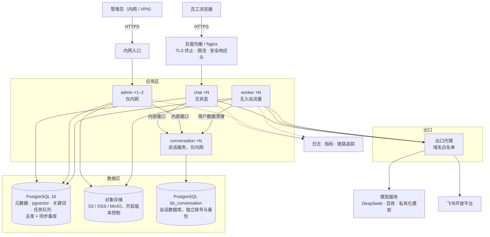

# 服务端部署

- 状态：设计中（未实施）
- 对应规划：[企业知识助手演进路线 · 第 4 节 部署形态的演进](../规划/企业知识助手演进路线.md)
- 决策记录：[ADR 0014](../adr/0014-服务端存储与任务队列.md)（提议中）
- 前置依赖：[身份与权限](./身份与权限.md)（服务端部署必须先有鉴权）
- 涉及模块：`server` `db` `storage` `rag` `ingest` `eval` `auth` `build` `docs`

## 1. 背景与触发条件

现在的部署形态面向本机单人使用：SQLite、本地 Chroma、`data/raw/` 文件目录、进程内 `BackgroundTasks`，只监听 `127.0.0.1`。ADR 0007 已经把应用拆成两个，但数据层仍然共享本地文件，进程内任务重启即中断，也没有并发控制。

规划的原则是“先保留 SQLite + Chroma 完成阶段 1、2，需要多用户、多进程时再迁移”。本方案先定义迁移的**触发条件**，满足其中任何一条再启动迁移：

| 条件 | 判断依据 |
| --- | --- |
| 需要多个问答实例（高可用或扩容） | SQLite 和本地 Chroma 不支持多实例共享 |
| 单个用户可见文档数接近 `KB_ACL_INLINE_LIMIT` | 见[身份与权限](./身份与权限.md) 8.1 |
| 后台任务被重启中断造成实际影响 | 重建、同步、评测出现 `interrupted` 并需要人工重跑 |
| 入库影响问答延迟 | 问答 p95 在同步或重建期间明显上升 |
| 需要正式的备份与恢复承诺 | 需要承诺 RPO / RTO 时 |
| 块数量超过 50 万 | 本地 Chroma 的内存和启动时间成为瓶颈 |

在触发之前，可以先做与存储无关的准备工作（第 12 节的步骤 1–2），这些工作对本地模式同样有收益。

## 2. 目标与非目标

**目标**

| 项 | 目标 |
| --- | --- |
| 可用性 | 工作时间问答可用性 99.9%；任一问答实例故障不影响服务 |
| 性能 | 问答首字 p95 ≤ 3 秒；50 个并发问答时不退化 |
| 数据可靠性 | RPO ≤ 15 分钟，RTO ≤ 1 小时；每季度演练一次恢复 |
| 任务可靠性 | 重建、同步、评测在进程重启后可以继续或重试，不会重复执行 |
| 一致性 | 并发操作不会丢失更新、不会切到不完整的索引 |
| 安全 | 网络分区、最小权限的数据库账号、密钥集中管理、全链路 HTTPS |
| 本地模式 | 继续支持 `uv run kb-studio` 零依赖启动；同一套代码按配置选择存储实现 |

**非目标**

- 多租户 SaaS、跨地域多活。
- Kubernetes Operator、自动扩缩容策略：提供镜像和 Helm 示例，具体编排由运维平台决定。
- 替换模型供应商：只提供接入私有化模型的配置能力。

## 3. 目标拓扑



| 组件 | 职责 | 说明 |
| --- | --- | --- |
| chat | 问答；通过会话服务读写对话与反馈 | 无状态，水平扩展；不访问对象存储 |
| admin | 管理接口、提交任务 | 只在内网开放；不执行耗时任务 |
| worker | 入库、同步、重建、评测、定时任务 | 独立进程，按队列消费；可以按任务类型分组部署 |
| PostgreSQL | 元数据、向量、关键词索引、任务队列、登录会话 | 一个数据库，多个 schema；见第 4 节 |
| 对象存储 | 原始文件和解析结果 | 替代 `data/raw/` |
| conversation | 会话服务：对话、消息、反馈 | 独立数据库 `kb_conversation`；无状态，可多实例；见[会话服务](./会话服务.md) |

四个应用使用同一个镜像，用不同的启动命令：`kb-studio-chat`、`kb-studio-admin`、`kb-studio-worker`、`kb-studio-conversation`。

## 4. 存储选型

### 4.1 向量库

| 方案 | 权限过滤 | 与元数据的一致性 | 规模 | 运维 | 结论 |
| --- | --- | --- | --- | --- | --- |
| Chroma 服务端 | `doc_id $in`，上限受列表长度限制 | 跨库，需要对账 | 中 | 多一个服务 | 只作为过渡（ADR 0007 已支持） |
| **PostgreSQL + pgvector** | **SQL JOIN `document_acl`，没有列表上限** | **同库同事务** | HNSW 索引，千万级以内 | 与元数据库合并，少一个组件 | **采用** |
| Milvus / Qdrant | 需要把权限写入向量元数据 | 跨库 | 亿级 | 独立集群 | 块数量超过千万或 QPS 很高时再评估 |

选择 pgvector 的主要原因是**权限过滤和事务一致性**：

- 权限检查变为一次 JOIN，始终以 `document_acl` 为准；阶段 2 中“单用户可见文档数上限”和“块元数据不存权限”的约束随之取消。
- 文档状态、块和关键词索引在同一个事务中写入，不再需要对账。
- 少运维一个有状态组件。

### 4.2 索引版本的映射

为了保持“一个索引版本对应一组独立数据，切换就是改指针”的模型（ADR 0002），每个索引版本对应一张表：

```sql
CREATE TABLE kb_index.chunks_v12 (
    chunk_id    TEXT PRIMARY KEY,               -- {doc_id}:{序号}，规则不变
    doc_id      BIGINT NOT NULL REFERENCES kb.documents(id),
    version     INT NOT NULL,
    section     TEXT NOT NULL,
    content     TEXT NOT NULL,
    embedding   vector(1024) NOT NULL,          -- 维度随该版本的 Embedding 模型固定
    tsv         tsvector NOT NULL               -- 预分词结果，见 4.3
);
CREATE INDEX ON kb_index.chunks_v12 USING hnsw (embedding vector_cosine_ops);
CREATE INDEX ON kb_index.chunks_v12 USING gin (tsv);
CREATE INDEX ON kb_index.chunks_v12 (doc_id);
```

- 不同 Embedding 模型的维度不同，一张表只能有一个固定维度，因此按版本分表比分区更合适。
- 切换索引仍然是更新 `current_index_id`；删除版本就是 `DROP TABLE`。
- 检索 SQL 示意（访问范围是一个子查询，不再传入 ID 列表）：

```sql
SELECT c.chunk_id, 1 - (c.embedding <=> $1) AS relevance
FROM kb_index.chunks_v12 c
JOIN kb.documents d ON d.id = c.doc_id AND d.status = 'indexed' AND NOT d.blocked
WHERE EXISTS (
    SELECT 1 FROM kb.document_acl a
    WHERE a.doc_id = c.doc_id AND a.principal = ANY($2)
)
ORDER BY c.embedding <=> $1
LIMIT $3;
```

- 带过滤条件的 HNSW 查询可能返回不足 `LIMIT` 条结果。实施时启用 pgvector 的迭代扫描（`hnsw.iterative_scan`，0.8 及以上版本），并在评测中验证权限范围很窄的用户的召回率。

### 4.3 关键词检索

| 方案 | 说明 | 结论 |
| --- | --- | --- |
| **jieba 预分词 + `simple` 配置的 tsvector** | 与阶段 3 的分词完全一致；不需要数据库扩展；`ts_rank_cd` 排序 | **首选**：托管数据库通常不允许安装中文分词扩展 |
| `zhparser` / `pg_jieba` 扩展 | 数据库内分词 | 依赖扩展，托管服务不一定支持 |
| ParadeDB `pg_search` | 真正的 BM25 | 依赖扩展；排序质量更好，可以作为后续优化 |
| Elasticsearch | 能力最强 | 多一个集群；只在全文检索成为核心需求时引入 |

`ts_rank_cd` 不是严格的 BM25，排序结果会与 SQLite FTS5 有差异。迁移验收时，用阶段 3 的检索指标对比，差异超出范围时再评估 `pg_search`。

### 4.4 原始文件

- `storage` 抽象为 `RawStore` 协议，提供本地文件系统（现有实现）和 S3 兼容（OSS、MinIO）两种实现，用 `KB_RAW_STORE_URL` 选择。
- 键名规则不变：`raw/<doc_id>/v<n>/<文件名>`、`raw/<doc_id>/v<n>/parsed.md`。
- 存储桶开启版本控制和服务端加密；应用账号只有读写权限，没有删除版本的权限。

## 5. 数据访问层

当前的 repo 直接使用标准库 `sqlite3`，SQL 写在 repo 中，没有 ORM。同时支持 SQLite 和 Postgres 的方案：

| 方案 | 说明 | 结论 |
| --- | --- | --- |
| 两套 repo | 每个 repo 实现两遍 | 重复、容易不一致，排除 |
| SQLAlchemy ORM | 完整 ORM | 与项目“不引入 ORM”的取向不符，学习和调试成本高 |
| **SQLAlchemy Core + Alembic** | 只用表定义和 SQL 表达式；连接池、方言差异、迁移交给成熟工具 | **采用** |

- repo 的函数签名不变，内部改用 SQLAlchemy Core。业务层不感知数据库类型。
- 少数必须使用方言特性的地方（向量检索、全文检索、`SKIP LOCKED`）放在 `rag/retrieval/` 和任务队列的方言实现中，不散落在 repo 里。
- 迁移改用 Alembic，替代阶段 1 引入的 `PRAGMA user_version`。已有的 `user_version` 编号对应 Alembic 的前几个版本，首次切换时按 `user_version` 自动标记，已有数据库不需要重新迁移。
- 服务端模式下**迁移不在应用启动时执行**（`KB_AUTO_MIGRATE=false`）：迁移作为部署流水线中的独立步骤运行，多个实例同时启动时不会竞争。本地模式保持启动时自动迁移。
- 表结构变更遵循“先扩展、后收缩”：先加新列或新表并兼容旧代码，所有实例升级后再删除旧列，保证滚动发布期间新旧版本可以同时运行。

## 6. 任务队列

### 6.1 选型

| 方案 | 新增组件 | 可靠性 | 本地模式 | 结论 |
| --- | --- | --- | --- | --- |
| Celery + Redis / RabbitMQ | 消息中间件 | 成熟 | 需要额外安装 | 功能多，但对当前任务量来说偏重 |
| Dramatiq / arq / RQ | Redis | 成熟 | 需要 Redis | 同上 |
| procrastinate | 无（基于 Postgres） | 成熟 | 不支持 SQLite | 服务端合适，本地模式要另写一套 |
| **自建 `jobs` 表** | 无 | 用 Postgres `SKIP LOCKED` / SQLite `BEGIN IMMEDIATE` 实现租约 | 同一套代码 | **采用** |

任务量很小（每天几十到几百个），而且任务语义（幂等键、进度、协作式取消、与业务状态同库同事务）和业务关系密切。自建一个约 200 行的队列，比引入中间件更简单，也能让本地模式和服务端使用同一套语义。任务量或任务类型明显增长时，再迁移到 procrastinate；接口保持不变。

### 6.2 任务模型

```sql
CREATE TABLE jobs (
    id               BIGSERIAL PRIMARY KEY,
    kind             TEXT NOT NULL,          -- ingest_document / sync_source / acl_refresh / rebuild_index / run_eval / retention ...
    payload          JSONB NOT NULL,
    idempotency_key  TEXT,                   -- 如 sync:source:3、rebuild:index:12
    status           TEXT NOT NULL,          -- queued / running / succeeded / failed / cancelled / dead
    priority         INT NOT NULL DEFAULT 100,
    attempts         INT NOT NULL DEFAULT 0,
    max_attempts     INT NOT NULL DEFAULT 3,
    run_after        TIMESTAMPTZ NOT NULL DEFAULT now(),
    leased_until     TIMESTAMPTZ,            -- 租约，worker 定期续约
    worker_id        TEXT,
    cancel_requested BOOLEAN NOT NULL DEFAULT false,
    progress         JSONB NOT NULL DEFAULT '{}',
    error            TEXT,
    created_by       BIGINT,                 -- 操作人，系统任务为空
    created_at       TIMESTAMPTZ NOT NULL DEFAULT now(),
    finished_at      TIMESTAMPTZ
);
CREATE UNIQUE INDEX ON jobs (idempotency_key) WHERE status IN ('queued', 'running');
```

| 语义 | 实现 |
| --- | --- |
| 同一对象只有一个活跃任务 | 幂等键上的部分唯一索引；重复提交返回已有任务（接口返回 409 和已有任务 ID） |
| 领取 | `UPDATE … WHERE id = (SELECT id … FOR UPDATE SKIP LOCKED LIMIT 1)`，同时设置租约 |
| 心跳 | 每 30 秒续约；租约过期的 `running` 任务被重新领取，`attempts` 加一 |
| 重试 | 指数退避（30 秒、2 分钟、10 分钟）；超过 `max_attempts` 记为 `dead`，在后台告警 |
| 取消 | 设置 `cancel_requested`；任务在每处理完一篇文档时检查，清理后记为 `cancelled` |
| 进度 | 任务写 `progress`（如 `{done: 120, total: 300}`），前端轮询任务接口 |
| 幂等 | 每种任务都必须能安全重跑：入库按哈希跳过、同步按对比跳过、重建按块 ID 覆盖写入 |

现有的 `index_versions.status`、`sync_runs` 等业务状态保留，任务表只负责“执行”。业务记录上增加 `job_id` 方便关联。

### 6.3 定时任务

- 调度器在 worker 中运行，用 Postgres advisory lock 选主：只有拿到锁的 worker 负责按时间投递定时任务，其他 worker 只消费。这解决了阶段 1“管理应用只能部署一个实例”的限制。
- 定时任务包括：数据源同步、权限刷新、用户状态复核、会话与审计日志清理、评测运行记录清理。
- 投递时使用带时间窗口的幂等键（如 `sync:source:3:2026-10-23T10:15`），即使发生主备切换也不会重复投递。
- 本地模式下，worker 以线程形式在管理应用进程内运行，使用同一套表和语义。

## 7. 并发控制

| 场景 | 问题 | 处理 |
| --- | --- | --- |
| 同一文档同时被同步和手动重新入库 | 两次写入交错，块和状态不一致 | 入库任务的幂等键为 `ingest:doc:<id>`，同一文档串行执行 |
| 两个管理员同时修改运行参数 | 后保存的覆盖先保存的 | 运行参数带 `revision`；`PUT` 必须带 `If-Match`，不一致时返回 412，前端提示刷新 |
| 文档列表上的状态变化 | 同上 | `documents` 增加 `row_version`，更新时作为条件，影响行数为 0 时重试或报错 |
| 同时切换索引 | 两次切换交错，统计不一致 | 切换使用条件更新（比较当前值后再设置），并在一个事务中完成状态同步 |
| 重建期间有新的入库 | 新索引中缺少重建期间的变化（现有的已知限制） | 重建开始时记录 `documents` 的变更序号；写完全部文档后，补写变更序号大于起点的文档，然后才进入评测 |
| 删除正在被问答使用的索引 | 问答中途读不到表 | 只能删除非当前版本；删除前等待 `KB_INDEX_DROP_GRACE_SEC`（默认 60 秒），让正在执行的检索完成 |

## 8. 安全基线

| 领域 | 要求 |
| --- | --- |
| 网络 | 问答入口对办公网开放；管理入口只对内网或 VPN 开放；worker 没有入站端口；数据库和对象存储只允许应用区访问；出站流量经过代理，按域名白名单放行（模型服务、飞书） |
| 传输 | 全部 HTTPS；开启 HSTS；内部服务之间的流量按公司要求加密 |
| 数据库账号 | `kb_chat`：知识库相关表只读，可以写登录会话；`kb_admin`：读写业务表，不能执行 DDL；`kb_worker`：读写业务表，可以创建和删除 `kb_index` schema 下的表；`kb_migrator`：只在迁移时使用。审计日志表对所有应用账号只开放 INSERT 和 SELECT。会话数据库 `kb_conversation` 只有会话服务的账号 `kb_conversation_app` 可以访问，其他应用账号没有任何权限。这一条落实了 ADR 0007 中“数据层权限隔离”的后续工作 |
| 密钥 | 由密钥管理服务注入环境变量，不写入镜像和配置文件；支持轮换后滚动重启生效；`backend/.env` 只用于本地 |
| 应用层 | 安全响应头（CSP、`X-Content-Type-Options`、`frame-ancestors`）；请求体大小限制；问答按用户限流（默认每分钟 20 次），登录按 IP 限流；CORS 只允许配置的源 |
| 模型数据外发 | 模型地址可配置（`KB_CHAT_BASE_URL`、`KB_EMBEDDING_BASE_URL`、`KB_RERANK_BASE_URL`），支持接入私有化部署的 OpenAI 兼容服务；`KB_ALLOWED_MODEL_HOSTS` 白名单在启动时校验，避免误配置把数据发到未经批准的地址 |
| 供应链 | CI 中执行依赖漏洞扫描（`pip-audit`、`pnpm audit`）和镜像扫描；镜像使用非 root 用户运行 |

## 9. 可观测性

**日志**：JSON 格式，每条带 `request_id`、`app`、`user_id`、`job_id`。不记录片段正文、token、密码；问题原文只记录在会话表中，不写入应用日志。

**链路追踪**：OpenTelemetry，问答请求拆成 `rewrite`、`retrieve.vector`、`retrieve.lexical`、`rerank`、`llm.first_token`、`llm.stream` 几个 span，与阶段 3 的检索追踪信息使用同一套耗时字段。

**指标**（Prometheus）：

| 类别 | 指标 |
| --- | --- |
| 问答 | QPS、首字延迟和总延迟的 p50 / p95、错误率、降级次数、拒答率、点踩率 |
| 模型 | 各模型调用次数、延迟、错误率、token 用量（按天汇总费用） |
| 任务 | 各类任务的排队数、执行时长、失败与 `dead` 数量、最长排队时间 |
| 同步 | 各数据源最近一次成功时间、失败数、删除保护触发次数 |
| 数据库 | 连接池使用率、慢查询、复制延迟 |

**健康检查**：`/healthz` 只检查进程存活；`/readyz` 检查数据库连接、迁移版本与代码一致、当前索引的表存在。迁移版本不一致时，`/readyz` 失败，新实例不接流量。

**告警**：问答错误率 > 2%（5 分钟）；首字 p95 > 5 秒；出现 `dead` 任务；数据源超过 2 个同步周期没有成功；复制延迟 > 60 秒；权限二次校验拦截到越权结果（任何一次都告警）。

## 10. 备份与恢复

| 数据 | 方式 | 恢复 |
| --- | --- | --- |
| PostgreSQL | 持续 WAL 归档 + 每日全量；同步备库 | 按时间点恢复（PITR），满足 RPO ≤ 15 分钟 |
| 对象存储 | 版本控制 + 跨可用区复制 | 按版本恢复 |
| 会话数据库 | 独立的 WAL 归档与每日全量，RPO ≤ 1 小时 | 独立恢复，不影响知识库；备份同样受保留期限约束，过期备份按期删除 |
| 向量与关键词索引 | 随数据库一起备份 | 也可以由原始数据重建，但需要重新调用 Embedding，有费用和耗时，所以不把“可以重建”当作备份 |

- 每季度在隔离环境演练一次恢复：恢复数据库和对象存储，启动服务，回归测试结果与恢复前一致即算通过，记录实际 RTO。
- 恢复到某个时间点之后，对象存储中可能存在比数据库更新的文件。这不影响正确性：数据库中没有登记的版本文件不会被读取，由每周的清理任务删除。

## 11. 交付

| 产物 | 说明 |
| --- | --- |
| 镜像 | 多阶段构建：前端构建产物 + 后端；一个镜像，三种启动命令；非 root 用户 |
| `deploy/compose.yaml` | 用于测试环境和演示：Postgres（pgvector）、MinIO、chat、admin、worker、conversation、Nginx |
| `deploy/helm/` | Kubernetes 示例：chat 使用 Deployment + HPA，admin 和 worker 使用 Deployment，迁移使用 Job |
| 配置清单 | 全部 `KB_*` 环境变量的说明、默认值和是否必填，放在 `docs/部署说明.md` 中 |
| 发布流程 | 构建镜像 → 运行迁移 Job → 滚动更新 worker → admin → chat；任一步失败即停止 |

## 12. 迁移路径

### 12.1 步骤

| 步骤 | 内容 | 是否依赖 Postgres | 可单独验收 |
| --- | --- | :-: | --- |
| 1 | 任务队列（SQLite 实现）替代 `BackgroundTasks`；重建期间变更的补写；运行参数和文档的乐观并发控制 | 否 | 重启后端，正在重建的任务可以继续 |
| 2 | SQLAlchemy Core + Alembic 替代 `sqlite3` 和 `user_version`；`RawStore`、向量检索、关键词检索按接口拆分实现 | 否 | 行为不变，检查全部通过 |
| 3 | Postgres 实现：业务表、`chunks_v*`、关键词检索、任务队列方言；S3 兼容的原始文件存储 | 是 | 新建的空环境可以完整运行 |
| 4 | 数据迁移命令 `kb-studio migrate-storage`（见 12.2） | 是 | 已有数据迁移后回归测试结果一致 |
| 5 | 镜像、compose、Helm、可观测性、安全基线、备份演练 | 是 | 第 2 节的目标逐项验收 |

步骤 1、2 对本地模式也有收益，可以在触发条件满足之前完成。

### 12.2 数据迁移

`kb-studio migrate-storage --from local --to postgres`：

1. 源端只读：迁移期间管理应用进入维护模式，问答继续使用旧环境。
2. 迁移业务表：按主键原样复制，保留全部 ID，块 ID 和外键不变。
3. 迁移索引：对每个 `ready` 状态的索引版本，从 Chroma 读出块、元数据和向量，写入对应的 `chunks_v*` 表；关键词列按该版本记录的分词配置重新分词。**不重新调用 Embedding。**
4. 迁移原始文件：从 `data/raw/` 上传到对象存储，逐个校验哈希。
5. 校验：各表行数、各索引版本的块数、抽样内容哈希一致；对当前索引运行回归测试，关键词通过率与迁移前一致，检索指标的差异在允许范围内（关键词排序算法不同，见 4.3）。
6. 切换：入口指向新环境，旧环境保留只读副本 30 天作为回退手段。

回退：切换后 30 天内发现问题时，入口切回旧环境。切换后新环境产生的数据（会话、反馈、同步的新版本）需要按时间导出补回，这一点在迁移窗口的通知中说明。

## 13. 待确认事项

| 事项 | 建议 | 说明 |
| --- | --- | --- |
| 向量库 | PostgreSQL + pgvector | 主要理由是权限 JOIN 和同库事务；超过千万块再评估 Milvus |
| 数据访问层 | SQLAlchemy Core + Alembic，不用 ORM | 需要同时支持 SQLite 和 Postgres |
| 任务队列 | 自建 `jobs` 表 | 本地模式和服务端使用同一套语义；任务量增长后可以迁移到 procrastinate |
| 关键词检索在 Postgres 上的实现 | jieba 预分词 + `simple` tsvector | 托管数据库不一定支持中文分词扩展；排序差异用评测验证 |
| 步骤 1、2 是否提前做 | 提前，在阶段 2 之后、触发条件满足之前 | 解决重启中断和并发问题，对本地模式同样有收益 |
| 目标 SLO | 第 2 节的数值 | 需要与实际使用规模和运维能力核对 |
| 部署平台 | 提供 compose 和 Helm 示例 | 取决于公司的运维平台 |
