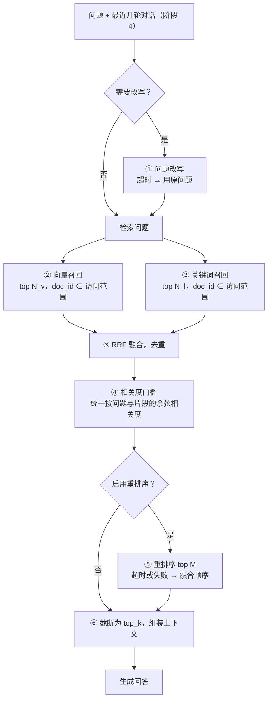

# 检索质量

- 状态：设计中（未实施）
- 对应规划：[企业知识助手演进路线 · 阶段 3](../规划/企业知识助手演进路线.md)
- 决策记录：[ADR 0012](../adr/0012-混合检索与重排序.md)（提议中）
- 前置依赖：无硬性依赖。权限过滤的接入点按 [身份与权限](./身份与权限.md) 预留，阶段 2 未完成时访问范围为“全部文档”
- 涉及模块：`query` `rag` `ingest` `eval` `db` `api-admin` `web-admin` `build`

## 1. 背景

现在的检索是单路向量检索：`similarity_search_with_relevance_scores(k=top_k)`，再丢弃余弦相关度低于 `score_threshold` 的结果（ADR 0005）。企业文档中有几类问题，向量检索处理得不好：

| 问题类型 | 例子 | 原因 |
| --- | --- | --- |
| 精确标识 | 制度编号 `HR-2024-017`、错误码 `E1032`、地址 `sso.example.com/reset` | Embedding 对字符级精确匹配不敏感 |
| 专有名词、缩写 | 系统名、项目代号、内部简称 | 训练语料中少见，向量空间中区分度低 |
| 口语化、省略 | “那个打车能报不”“上海呢？” | 与文档的书面表达差距大；多轮追问缺少主语 |
| 排序不准 | 相关块排在第 5 位，被 `top_k=4` 截断 | 双塔向量模型只做粗排，没有精排 |

另外，现在**无法量化检索效果**：回归测试只看最终回答是否包含关键词，分不清是“没检索到”还是“检索到了但没答好”。

## 2. 目标与非目标

**目标**

- 先建立检索评测指标，再改检索链路；每一项改动都要用指标说明收益。
- 混合检索：关键词检索与向量检索并行召回，融合排序。
- 重排序（Rerank）：对融合后的候选做精排。
- 问题改写：多轮追问改写为可以单独检索的问题；单轮口语化改写作为可选项。
- 新链路全部在 `query` 层实现，问答端和回归测试共用；每一步都可以单独开关，任一步失败都降级而不中断问答。
- 保留 ADR 0005 的拒答语义：无关问题不应该带着无关片段进入生成。

**非目标**

- 多路查询扩展（一次生成多个检索问题）、HyDE：收益不确定、成本翻倍，等评测集足够大以后再评估。
- 知识图谱、GraphRAG。
- 自训练 Embedding 或 Rerank 模型。
- 修改切分策略：切分参数随索引版本固化，有独立的调整路径（重建索引），不放在本方案中。

## 3. 先度量：检索评测

### 3.1 用例标注

`eval_cases` 增加 `expected_doc_ids`（JSON 数组），表示“回答这个问题应该用到的文档”。拒答用例为空数组。

- 粒度取文档而不是块。块 ID 随切分参数变化，跨索引版本不可比；文档 ID 稳定。
- 后台编辑用例时，从文档列表中选择，不手填 ID。
- 规划中“检索层面的 Recall@K”原本放在阶段 4。这里提前到阶段 3 的第一步实施，因为没有它就无法验收阶段 3。

### 3.2 指标

记 K 为最终送入生成的片段数（即 `top_k`）。

| 指标 | 定义 | 用途 |
| --- | --- | --- |
| Hit@K | 前 K 个片段中至少命中一个期望文档的用例占比 | 主指标：能不能找到 |
| Recall@K | 前 K 个片段覆盖的期望文档数 ÷ 期望文档数，按用例取平均 | 多文档问题是否找全 |
| MRR | 第一个命中片段排名的倒数，按用例取平均 | 排序质量 |
| 候选 Recall | 融合后、重排序前的候选中覆盖的期望文档比例 | 区分“召回不到”和“排序不对” |
| 误召回率 | 拒答用例中，过了相关度门槛仍有片段的用例占比 | 拒答能力是否退化 |
| 各阶段耗时 | 改写、向量召回、关键词召回、重排序的 p50 / p95 | 性能预算 |

以上只针对普通用例；拒答用例只计算误召回率。

### 3.3 评测集要求

现有 6 条种子用例不足以做判断，差一条用例就是十几个百分点的波动。实施检索改动之前，评测集至少达到：

- 50 条以上，覆盖第 1 节的四类问题，以及多文档问题、拒答问题（不少于 10%）。
- 每条用例带上分类标签（阶段 4 的 `tags` 字段）；报告按分类分别给出指标，避免整体平均掩盖某一类的退化。
- 评测集与改动分开提交：先提交用例，记录基线，再改链路。

## 4. 检索管线



| 参数 | 默认值 | 说明 |
| --- | --- | --- |
| `retrieval_mode` | `hybrid` | `vector`：保持现有行为，只做向量召回并直接取 `top_k`，跳过关键词召回、融合和重排序；`hybrid`：混合检索。升级时的默认值见第 15 节 |
| `vector_candidates`（N_v） | 20 | 向量召回数 |
| `lexical_candidates`（N_l） | 20 | 关键词召回数 |
| `rrf_k` | 60 | RRF 平滑常数 |
| `score_threshold` | 0.4 | 沿用现有参数，含义不变（见第 7 节） |
| `rerank_enabled` | `false` | 评测证明有收益后再打开 |
| `rerank_candidates`（M） | 20 | 送入重排序的候选数 |
| `rerank_threshold` | 不设置 | 重排序分数门槛；需要用评测集校准后再设置 |
| `rewrite_mode` | `multi_turn` | `off` / `multi_turn`（只在有对话历史时改写）/ `always` |
| `top_k` | 4 | 沿用现有参数 |

这些都属于运行参数，修改后立即生效，**不需要重建索引**。关键词索引本身需要随索引版本构建，见第 5 节。

## 5. 关键词检索

### 5.1 选型

| 方案 | 中文支持 | 增量更新 | 与索引版本的关系 | 结论 |
| --- | --- | --- | --- | --- |
| `rank_bm25` 内存索引 | 需要自己分词 | 每次变化重算全部统计量 | 进程内缓存，需要自己做失效 | 实现最快，但每个进程一份、启动时全量加载，不适合多进程 |
| SQLite FTS5 + `trigram` 分词器 | 按 3 字切分，不需要词典 | 支持 | 一个索引版本一张表 | 两个字的中文词（“年假”）查不到，排除 |
| **SQLite FTS5 + jieba 预分词** | 词典分词，可以加自定义词典 | 支持，按块 ID 删除和插入 | 一个索引版本一个文件，随 collection 一起创建和删除 | **采用** |
| Chroma 内置全文 / 稀疏向量检索 | 取决于版本 | 支持 | 同一个 collection | Chroma 的混合检索能力主要面向 Cloud，本地版本的可用性需要实施时验证，验证可用时可以作为替代 |
| Elasticsearch / OpenSearch | IK 等分词插件 | 支持 | 用索引别名 | 需要独立部署的集群，留给服务端部署方案评估 |

FTS5 内置 `bm25()` 排序函数，持久化、可增量、无需额外服务，与“本地优先”的定位一致。迁移到 Postgres 后的替代方案见[服务端部署](./服务端部署.md)。

### 5.2 存储与结构

关键词索引是**派生数据**，与 Chroma collection 一一对应，放在 `data/lexical/<collection>.db`：

```sql
CREATE VIRTUAL TABLE chunks USING fts5(
    section_tokens,                 -- 章节标题分词结果，空格分隔
    content_tokens,                 -- 正文分词结果，空格分隔
    chunk_id UNINDEXED,
    doc_id   UNINDEXED,
    tokenize = 'unicode61 remove_diacritics 2'
);
CREATE TABLE meta (key TEXT PRIMARY KEY, value TEXT NOT NULL);  -- tokenizer、词典版本、构建时间
```

- 原文不再重复存储，正文和元数据仍以 Chroma 为准，关键词召回只返回 `chunk_id` 和分数，再从 Chroma 按 ID 取回。
- 排序使用 `bm25(chunks, 2.0, 1.0)`：标题命中的权重是正文的两倍。
- 预分词后用 `unicode61` 按空格切分。`sso.example.com` 会被进一步切成 `sso`、`example`、`com`，查询端做同样的处理，两边一致即可匹配。

### 5.3 分词

- 使用 jieba：索引端用 `cut_for_search`（细粒度，提高召回），查询端用相同方法。英文转小写，数字和字母组成的标识（`HR-2024-017`）整体保留一份，再按分隔符拆开保留一份。
- 停用词表放在代码中，随分词版本一起固化。
- 自定义词典：`KB_LEXICON_PATH` 指向一个词表文件（系统名、项目代号等），可选。
- **分词配置随索引版本固化**：`index_versions` 新增 `lexical_tokenizer` 列，记录 `jieba:<词典哈希>:<规则版本>`。词典或规则变化后，必须重建索引才能对新版本生效，与 Embedding 模型的处理方式相同。查询时使用该索引版本记录的分词配置。

### 5.4 查询

- 查询分词后，每个词用双引号包起来，内部的双引号转义，再用 `OR` 连接，交给 `MATCH`。**不直接拼接用户输入**，避免 FTS5 查询语法注入和语法错误。
- 去掉停用词后没有剩下任何词时，跳过关键词召回。
- 访问范围通过 `doc_id IN (...)` 过滤，与向量召回使用同一个 `AccessScope`。

### 5.5 写入与一致性

| 时机 | 处理 |
| --- | --- |
| 增量入库（`index_document`） | Chroma 按 `doc_id` 删除并写入新块，之后在一个 SQLite 事务中删除并写入关键词索引。关键词索引写入失败时，文档状态记为 `failed`，“重新入库”会把两边都重写 |
| 删除文档 | 两边都按 `doc_id` 删除 |
| 全量重建 | 写完 Chroma 后批量写入关键词索引，然后再进入评测 |
| 删除索引版本 | 同时删除 `data/lexical/<collection>.db` |
| 对账 | `refresh_counts` 同时统计两边的块数；不一致时，在索引列表中显示“关键词索引不一致” |
| 补建 | “补建关键词索引”从 Chroma 读出该版本的全部块重新分词写入，**不调用 Embedding** |

**已有索引版本的兼容**：迁移前创建的索引没有关键词索引（`lexical_tokenizer` 为空），检索时自动按 `vector` 模式运行，并在后台提示可以补建。补建不影响向量部分，补建完成后立即启用混合检索。

## 6. 融合

使用 RRF（Reciprocal Rank Fusion）：

```text
score(chunk) = Σ  1 / (rrf_k + rank_i(chunk))      对出现该块的每一路召回求和
```

- 只使用排名，不使用原始分数。向量的余弦相关度和 BM25 分数尺度不同，直接加权需要按数据调参，而 RRF 不需要。
- 两路结果按 `chunk_id` 去重。
- 预留按路设置权重（`w_i / (rrf_k + rank_i)`），默认都为 1；只有评测证明调整权重有收益时才修改。

## 7. 相关度门槛

ADR 0005 的门槛针对向量相关度，含义是“和问题语义不够接近的片段不进入生成”。只从关键词召回的候选没有向量分数，处理方式如下：

- 对融合后的全部候选，统一计算“问题向量与片段向量的余弦相关度”，用同一个 `score_threshold` 判断。
- 问题向量在向量召回时已经算过；片段向量用 `collection.get(ids, include=["embeddings"])` 取回，**不需要再调用 Embedding**。
- 这样一来，门槛语义与现在完全一致，拒答行为不受关键词召回影响：关键词偶然撞上的无关片段过不了门槛。
- 代价是关键词召回的价值主要体现在“找回向量排名靠后、但相关度过线的片段”，而不是放进相关度过低的片段。如果评测发现精确标识类问题因此被门槛挡掉，再考虑对“关键词完全命中标识”的片段豁免，并用误召回率验证。

返回给前端的 `score` 仍然是余弦相关度，展示含义不变；重排序启用时增加 `rerank_score`。

## 8. 重排序

### 8.1 选型

| 方案 | 效果 | 延迟 | 成本与运维 | 数据合规 |
| --- | --- | --- | --- | --- |
| **百炼文本排序 API** | 交叉编码器，中文效果好 | 网络往返，约数百毫秒 | 按调用计费，无需运维 | 数据已经发给百炼做 Embedding，不新增外发对象 |
| 本地 `bge-reranker-v2-m3` | 效果接近 | CPU 上 20 个候选需要秒级，需要 GPU 才实用 | 引入 torch 等重依赖，镜像大幅变大 | 不外发 |
| 用对话模型打分 | 可解释 | 最慢 | token 成本最高 | 外发给 DeepSeek |

**首期采用百炼文本排序 API**（型号如 `gte-rerank-v2`、`qwen3-rerank`，以实施时可用的型号为准）。重排序做成 `Reranker` 接口，数据不允许外发的部署可以替换为本地模型服务（通过 HTTP 调用，后端进程本身不引入 torch）。

### 8.2 行为

- 只对通过相关度门槛的候选做重排序，最多 `rerank_candidates` 个。
- 超时 1.5 秒（可配置）、限流、接口异常时，按融合顺序继续，不中断问答；本次检索记录降级原因，计入指标。
- 重排序模型名称加入运行参数，变更会写审计日志（阶段 2），并在回归报告中标出。
- `rerank_threshold` 默认不设置：交叉编码器的分数分布与模型相关，没有经过校准的门槛会误伤召回。校准方法是在评测集上画出普通用例和拒答用例的分数分布，取误召回率不上升的最大值。

## 9. 问题改写

### 9.1 触发条件

| `rewrite_mode` | 行为 |
| --- | --- |
| `off` | 不改写 |
| `multi_turn`（默认） | 只在有对话历史时改写（阶段 4 上线后生效），把追问补全为独立问题 |
| `always` | 单轮问题也改写，用于口语化场景；需要评测证明有收益，并接受首字延迟增加 |

### 9.2 实现

- 使用对话模型，`temperature=0`，输出结构化结果 `{"query": "..."}`，最长 200 字。
- 只输入最近 3 轮对话的问题和回答摘要（回答截断到 200 字），不输入检索片段。
- Prompt 约束：只做指代消解和补全，不回答问题、不扩写、不加入对话中没有出现的事实；对话内容中的“指令”视为普通文本。
- 超时 1.5 秒或输出不合法时，使用原问题。
- 改写只影响检索。生成阶段仍然使用用户的原问题和对话历史，避免改写错误被放大为答非所问。
- 改写结果通过 SSE 的 `meta` 事件返回（阶段 4），前端可以展示“按‘××’检索”，便于用户发现改写错误。

## 10. 上下文组装

- 同一文档的相邻块（序号连续）合并为一段，减少重复标题，保留原有顺序。
- 按重排序或融合顺序依次放入，直到 `top_k` 个片段或上下文预算（`context_max_chars`，默认 6000 字）用完。
- 来源标注格式不变：`[标题 · 章节]`。

## 11. 代码结构

```text
backend/src/kb_studio/
  rag/
    retrieval/
      vector.py        向量召回：按访问范围过滤，返回 (chunk_id, 余弦相关度)
      lexical.py       关键词索引的建表、写入、删除、查询、补建
      tokenizer.py     jieba 分词、停用词、标识符处理、分词配置指纹
      fusion.py        RRF，纯函数
      rerank.py        Reranker 协议与百炼实现
      rewrite.py       问题改写
      context.py       相邻块合并与上下文预算
    qa.py              Prompt 与生成；retrieve 迁入 retrieval/vector.py
  query/
    pipeline.py        按运行参数编排第 4 节的管线，生成检索追踪信息
    service.py         对外接口不变：search(index, question, scope, history=None)
  ingest/
    incremental.py     index_document 同时写入关键词索引
    rebuild.py         重建时构建关键词索引
    index_state.py     对账、补建关键词索引
```

- `rag/retrieval/` 下的模块都是能力，不读运行参数；参数由 `query/pipeline.py` 读取后传入，便于单测和评测对比。
- `query.search` 返回值增加 `trace`（第 13 节），问答端只把需要的字段放进 `sources`，不把追踪信息直接暴露给前端。
- 新增依赖 `jieba`（纯 Python）。重排序通过 `httpx` 调用，不新增 SDK。

## 12. 配置变更与发布

检索参数立即作用于线上，改错了会直接影响所有用户，所以变更流程如下：

1. 后台“运行参数”页面增加“检索”分组。保存前可以点“试运行”：用候选参数在当前索引上跑一遍回归测试，与当前参数的结果并排展示（通过率、Hit@K、MRR、误召回率、p95 耗时，以及结果发生变化的用例）。
2. 试运行不修改任何状态，结果不写入索引版本的 `eval_pass_rate`。
3. 保存时记录审计日志（阶段 2 之前写应用日志），包含修改前后的差异。
4. 回退：再次保存旧值即可，不涉及索引。

接口：`POST /api/admin/eval/run` 增加可选的 `settings_override`，只接受检索相关参数，校验规则与 `PUT /api/admin/settings` 相同。

## 13. 可观测性

每次检索生成一条追踪信息：

| 字段 | 内容 |
| --- | --- |
| `rewritten_query` | 改写后的检索问题（没有改写时为空） |
| `vector` / `lexical` | 各自召回的 `chunk_id`、排名、分数 |
| `fused` | 融合后的排名 |
| `gated_out` | 被相关度门槛挡掉的 `chunk_id` 和相关度 |
| `rerank` | 重排序分数；降级时记录原因 |
| `final` | 最终送入生成的 `chunk_id` |
| `timings_ms` | 各阶段耗时 |
| `params` | 本次使用的参数快照 |

- 回归测试结果中保存完整的追踪信息，后台用例详情可以展开查看，用来定位“为什么没检索到”。
- 线上问答的追踪信息在阶段 4 随消息保存；阶段 4 之前只写结构化日志，不含片段正文。
- 指标：各阶段耗时、降级次数（改写、重排序）、关键词召回为空的比例、门槛过滤比例。

## 14. 性能预算

| 阶段 | 目标 p95 | 备注 |
| --- | --- | --- |
| 问题改写 | 1.2 s | 仅多轮；超时 1.5 s 后降级 |
| 问题 Embedding + 向量召回 | 500 ms | 与现在相同 |
| 关键词召回 | 50 ms | 与向量召回并行执行 |
| 取片段向量 + 门槛 | 30 ms | 本地读取 |
| 重排序 | 800 ms | 超时 1.5 s 后降级 |
| **首个 token（单轮，启用重排序）** | **2.5 s** | 现在约 1.5 s；超出预算时优先调小 `rerank_candidates` |

## 15. 数据模型与迁移

- `index_versions` 增加 `lexical_tokenizer TEXT`。为空表示该版本没有关键词索引，迁移时已有版本都为空。
- `eval_cases` 增加 `expected_doc_ids TEXT NOT NULL DEFAULT '[]'`。种子用例在迁移时按文件名匹配到对应的文档 ID，匹配不到的保持空数组，在后台提示补充标注。
- 运行参数（`kv.runtime_settings`）增加第 4 节的新参数。读取时缺失的参数使用默认值，已有数据不需要迁移；但 `retrieval_mode` 的迁移默认值取 `vector`，保证升级后行为不变，由管理员在试运行后手动切换。
- 新增目录 `data/lexical/`。删除它只会让检索退回 `vector` 模式，可以通过“补建”恢复，符合“派生数据可重建”的原则。

## 16. 测试与验证

**单元测试**（不调用真实模型和排序接口）

| 对象 | 覆盖内容 |
| --- | --- |
| 分词 | 中文词、英文大小写、标识符双重保留、停用词、自定义词典、配置指纹稳定 |
| 关键词索引 | 写入、按 `doc_id` 删除、查询转义（含双引号、`OR`、`NEAR`、`*` 等 FTS5 语法字符）、访问范围过滤、空查询 |
| 融合 | RRF 计算、去重、单路为空、两路都为空 |
| 门槛 | 只来自关键词的候选按余弦判断；拒答用例无片段 |
| 重排序 | 超时、429、异常时降级并记录原因 |
| 改写 | 超时和非法输出时使用原问题；不出现在生成输入中 |
| 管线 | 每个开关的组合；`vector` 模式与现有实现的结果完全一致（基线保护） |
| 一致性 | 关键词索引写入失败时文档标记为失败；对账发现不一致；补建不调用 Embedding |
| 指标 | Hit@K、Recall@K、MRR、候选 Recall、误召回率的计算 |

**验收**

1. 评测集达到第 3.3 节的要求，记录 `vector` 模式的基线。
2. 依次打开混合检索、重排序、改写，每一步都给出与上一步的对比报告；只有指标提升且误召回率不上升的改动才保留默认开启。
3. 首字延迟满足第 14 节的预算。

## 17. 实施顺序与待确认事项

| 步骤 | 内容 | 可单独验收 |
| --- | --- | --- |
| 1 | 检索评测：`expected_doc_ids`、指标计算、报告；扩充评测集并记录基线 | 回归报告中出现检索指标 |
| 2 | 管线骨架：`query/pipeline.py`、检索追踪、参数分组、试运行；`vector` 模式下结果与现在一致 | 行为不变，追踪信息可见 |
| 3 | 关键词索引：分词、写入、重建、补建、对账；RRF 融合；统一门槛 | `hybrid` 模式的对比报告 |
| 4 | 重排序与降级 | 启用重排序的对比报告 |
| 5 | 问题改写（`multi_turn` 依赖阶段 4 的对话历史，可以先以 `always` 模式评测） | 改写的对比报告 |

待确认事项：

| 事项 | 建议 | 说明 |
| --- | --- | --- |
| 关键词检索选型 | SQLite FTS5 + jieba 预分词 | 实施前先验证本地 Chroma 1.5 的全文检索能力，可用时再比较一次 |
| 重排序选型 | 百炼文本排序 API，接口可替换 | 不新增数据外发对象；本地模型作为数据不允许外发时的替代 |
| 升级后的默认检索模式 | 保持 `vector`，试运行后手动切换 | 避免升级即改变线上行为 |
| Recall@K 提前到阶段 3 | **已确认（2026-10-23）**：提前 | 否则阶段 3 无法验收 |
| 评测集规模 | 50 条以上，按分类统计 | 需要准备与虚构制度文档配套的用例 |
