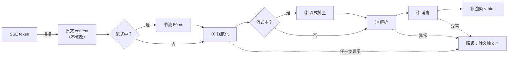

# 模型输出渲染管线

- 状态：已实施（未发布）
- 涉及模块：`web-shared` `web-chat` `web-admin` `eval` `rag`
- 决策记录：[ADR 0008](../adr/0008-模型输出渲染管线.md)
- 代码位置：`frontend/src/shared/utils/markdown/`、`frontend/src/shared/components/MarkdownContent.vue`

## 1. 背景

问答页的回答中原样出现 `**`、`***`、`#` 等符号。排查后确认有三方面原因：

| 现象 | 根因 |
| --- | --- |
| 所有 Markdown 语法都原样显示 | 模型输出的是 Markdown，前端用 `{{ content }}` + `whitespace-pre-wrap` 按纯文本显示 |
| 接入解析器后，部分加粗仍然失效 | CommonMark 的强调规则要求 `**` 两侧满足“分隔符边界”条件，紧贴中文标点时（`**“年假”**为`）判定失败 |
| 流式输出过程中闪出符号 | 输出到一半时语法未闭合，比如文本停在 `每年 **` |

此外，回答内容一部分来自知识库原文，一部分由模型生成，可能夹带 HTML 标签或 prompt 注入内容，直接 `v-html` 存在 XSS 和数据外带风险。回归测试的关键词判定也受到影响：`**5** 天` 匹配不上关键词 `5天`。

## 2. 目标与非目标

**目标**

- 回答按 Markdown 正确排版，中文强调能正常识别。
- 流式输出期间不闪现裸符号，排版不跳动。
- 渲染结果安全：不执行脚本，不加载外部资源，链接不泄露来源页。
- 问答页和回归测试页共用一套实现，渲染结果一致。
- 任何异常都不能导致页面白屏。

**非目标**

- 代码高亮、数学公式、Mermaid 图表：知识库是制度类文档，暂不需要，见第 9 节扩展方向。
- 在回答中展示图片：出于安全考虑明确不支持。
- 改变后端协议：SSE 事件和原文格式保持不变。

## 3. 设计原则

1. **原文是唯一真相源**：`message.content` 只保存按 token 拼接的模型原始输出，HTML 在渲染时派生，从不写回。复制、评估、排查问题都基于原文。
2. **分层、纯函数**：每一步只做一件事，输入是字符串，输出是字符串，可以单独测试；规范化步骤是幂等的。
3. **默认不信任**：模型输出一律按不可信内容处理，至少两层独立防护。
4. **流式与完成态分开处理**：补全逻辑只在流式期间生效，输出完成后严格按原文解析，避免“修复”改坏合法文本。
5. **失败降级**：任何一步抛出异常，都退回转义后的纯文本。

## 4. 整体流程



对外只暴露一个入口：

```ts
renderMarkdown(text: string, options?: { streaming?: boolean }): string
```

## 5. 各步骤说明

### ① 规范化 `normalize.ts`

| 处理 | 原因 |
| --- | --- |
| `\r\n`、`\r` 统一为 `\n` | 避免换行风格不同导致的解析差异 |
| 去掉零宽字符（`U+200B–200D`、`U+2060`）、BOM 和除 `\t` `\n` 以外的控制字符 | 不可见字符会打断语法识别，比如夹在 `*` 中间的零宽空格 |
| 剥离 `<think>…</think>`；流式期间只有开标签时，丢弃其后的全部内容 | 防御性处理。当前已关闭思考模式，但更换模型后可能输出推理过程 |
| 去掉开头的空白 | 避免首行被识别成缩进代码块 |

### ② 流式补全（仅 `streaming=true`）

采用 Vercel streamdown 的补全库 [remend](https://github.com/vercel/streamdown/tree/main/packages/remend)，可以补全未闭合的加粗、斜体、行内代码、删除线和链接。配置如下：

- `linkMode: 'text-only'`：未完成的链接只显示文字，不生成占位地址。
- `images: false`：图片在解析阶段已经禁用，这里不处理。

remend 无法处理一种情况：文本以开标记结尾、后面还没有内容，比如 `每年 **`。这时它没有可以包裹的内容，`**` 会原样显示出来。管线在调用 remend 之前，先用 `DANGLING_MARKER` 去掉末尾的 `*`、`_`、`~` 标记：

- 末尾是开标记：去掉后不显示，下一个 token 到达时自然恢复。
- 末尾是闭标记（`**5 天**`）：去掉后变成未闭合，再由 remend 补回，结果不变。

未闭合的代码块不需要补全：按 CommonMark 规范，没有收尾的 ```` ``` ```` 会一直延续到文档末尾，渲染为代码块。

### ③ 解析

使用 markdown-it，配置如下：

| 配置 | 值 | 原因 |
| --- | --- | --- |
| `html` | `false` | 原文中的 HTML 按文本输出，这是第一层防护 |
| `linkify` | `true` | 自动识别回答中的网址，例如 `https://sso.example.com/reset` |
| `breaks` | `true` | 模型习惯用单个换行分行，按段落合并会挤成一行 |
| `typographer` | `false` | 不替换引号和破折号，保持原文 |
| `markdown-it-cjk-friendly` | 启用 | 修正中文标点旁 `**` 无法识别的问题 |
| `image` 规则 | 禁用 | `` 会把检索到的内容拼进 URL，渲染时由浏览器自动请求，造成数据外带 |

链接地址由 markdown-it 默认的 `validateLink` 校验，`javascript:`、`vbscript:`、`file:` 和非图片的 `data:` 协议不会生成链接。

### ④ 消毒

使用 DOMPurify，是独立于解析器的第二层防护。即使以后有人误开 `html: true`，或者解析器本身出现漏洞，这一层仍然生效。

- 标签白名单：`p br strong em del s code pre blockquote ul ol li h1–h6 hr a table thead tbody tr th td`。
- 属性白名单：只保留 `href`、`target`、`rel`，禁止 `data-*`。
- `afterSanitizeAttributes` hook：所有 `<a>` 统一加 `target="_blank"` 和 `rel="noopener noreferrer nofollow"`，防止新页面拿到 `window.opener`，也不向外部站点发送来源地址。
- 使用独立实例 `DOMPurify()`，hook 不会影响其他地方的 DOMPurify。

### ⑤ 渲染 `MarkdownContent.vue`

```vue
<MarkdownContent :source="message.content" :streaming="message.pending" />
```

- 流式期间每个 token 都会整段重新解析，开销随长度增长。组件用 `refThrottled` 节流到 50ms，也就是每秒最多约 20 次；流式结束后立即用完整原文渲染一次。
- 样式在 `shared/assets/styles/markdown.css`，作用域限定在 `.md-content`，颜色全部取语义变量，自动适配暗色模式。没有引入 `@tailwindcss/typography`，以免和 Naive UI 的排版冲突。
- 使用范围：

| 位置 | 是否渲染 | 原因 |
| --- | --- | --- |
| 问答页的助手回答 | 是 | 主要场景 |
| 回归测试页的回答 | 是 | 与线上展示一致，评估时看到的就是用户看到的 |
| 用户输入 | 否 | 用户原样输入的文字，不做解释 |
| 检索片段 | 否 | 用于核对切块内容，需要看到原文 |

### 降级

`renderMarkdown` 整体包在 `try/catch` 里，异常时返回 `<p>` 包裹的转义原文，换行转成 `<br>`。降级结果不含任何来自原文的标签，可以安全地直接 `v-html`。

## 6. 安全模型

| 威胁 | 来源 | 防护 |
| --- | --- | --- |
| 脚本注入（`<script>`、`onerror`） | 知识库原文、模型被注入后输出 | `html:false` + DOMPurify 白名单，两层独立防护 |
| 危险协议链接 | 同上 | `validateLink` 不生成链接；DOMPurify 再次过滤 `href` |
| 图片外带数据 | prompt 注入诱导模型输出带参数的图片 | 禁用 image 规则；白名单中没有 `img` |
| 反向标签页劫持、Referer 泄露 | 回答中的外链 | 统一加 `rel="noopener noreferrer nofollow"` |
| 解析异常导致白屏 | 极端输入、依赖缺陷 | 降级为转义纯文本 |

Prompt 中同时约定“使用 Markdown 排版，不输出 HTML 和图片”，从源头减少违规输出。前端防护不依赖这条约定。

## 7. 后端配套调整

| 位置 | 调整 |
| --- | --- |
| `rag/qa.py` | Prompt 规则增加“使用 Markdown 排版，不要输出 HTML 和图片” |
| `evaluation/runner.py` | `_normalize` 在比较前去掉空白和 `* _ ` ~ #`，回答和关键词两边做同样处理 |

## 8. 测试与验证

**单元测试**（`frontend/tests/unit/shared/utils/markdown/`）

| 分组 | 覆盖内容 |
| --- | --- |
| 规范化 | 换行统一、不可见字符、`<think>` 剥离（含未闭合）、幂等性 |
| 格式 | 加粗、列表、标题、中文标点旁的加粗、单换行 |
| 流式补全 | 未闭合加粗、末尾悬空的开标记、末尾的闭标记、未闭合代码块、完成态不补全 |
| 安全 | `script`/`img`/`iframe` 不生成元素、`javascript:` 链接不可点击、图片不渲染、外链属性 |
| 降级 | 解析器抛出异常时返回转义文本 |

> 消毒相关的测试文件声明了 `// @vitest-environment jsdom`。在 happy-dom 下 DOMPurify 会丢失元素和 hook 设置的属性，测试结果不可信；其他测试仍使用 happy-dom。

**端到端验证**（独立数据目录和端口）

- 采集 4 段真实回答的 token 序列，覆盖有序/无序列表、自动链接和密集加粗。
- 对每个 token 前缀执行 `renderMarkdown(…, { streaming: true })`，统计去掉标签后仍出现 `*` 或行首 `#` 的次数。
- 首轮发现末尾悬空开标记的问题，一段回答闪现 12 次，加入 `DANGLING_MARKER` 后降为 0。
- 回归测试 6/6 通过。

## 9. 已知限制与扩展方向

| 项 | 现状 | 扩展方式 |
| --- | --- | --- |
| 图片 | 不显示 | 经后端图片代理并配置域名白名单后，再开启 image 规则并把 `img` 加入白名单 |
| 代码高亮 | 无 | 用 markdown-it 的 `highlight` 选项接入 Shiki，按需加载语言包 |
| 数学公式 | 无 | 接入 KaTeX 插件，同时开启 remend 的 `katex` 补全；DOMPurify 白名单需要放行 MathML |
| 长回答性能 | 每次整段解析，节流后在几 KB 以内无感知 | 按块增量渲染：只重新解析最后一个未完成的块，已完成的块缓存结果 |
| 复制回答 | 无 | 复制 `message.content` 原文，而不是渲染后的 HTML |
| 来源标注 | 末尾「来源：…」按普通段落显示 | 解析为结构化引用，与检索片段联动 |

## 10. 维护约定

- 新增标签或属性时，必须同时更新 DOMPurify 白名单和安全测试，并在 PR 中说明理由。
- 不要关闭 `html: false`，也不要绕过 `renderMarkdown` 直接 `v-html` 模型输出。
- 修改补全逻辑后，用真实 token 序列重新做一次逐前缀渲染检查。
- 升级 `markdown-it`、`remend`、`dompurify` 后运行 `scripts/check.sh`，重点关注 `render.test.ts`。
