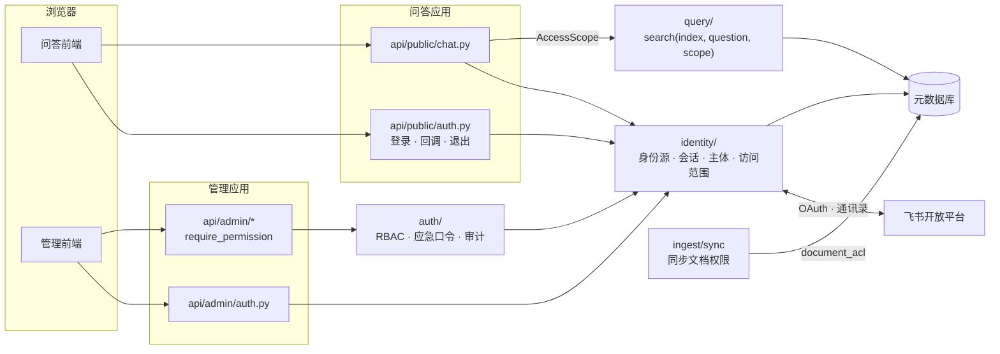
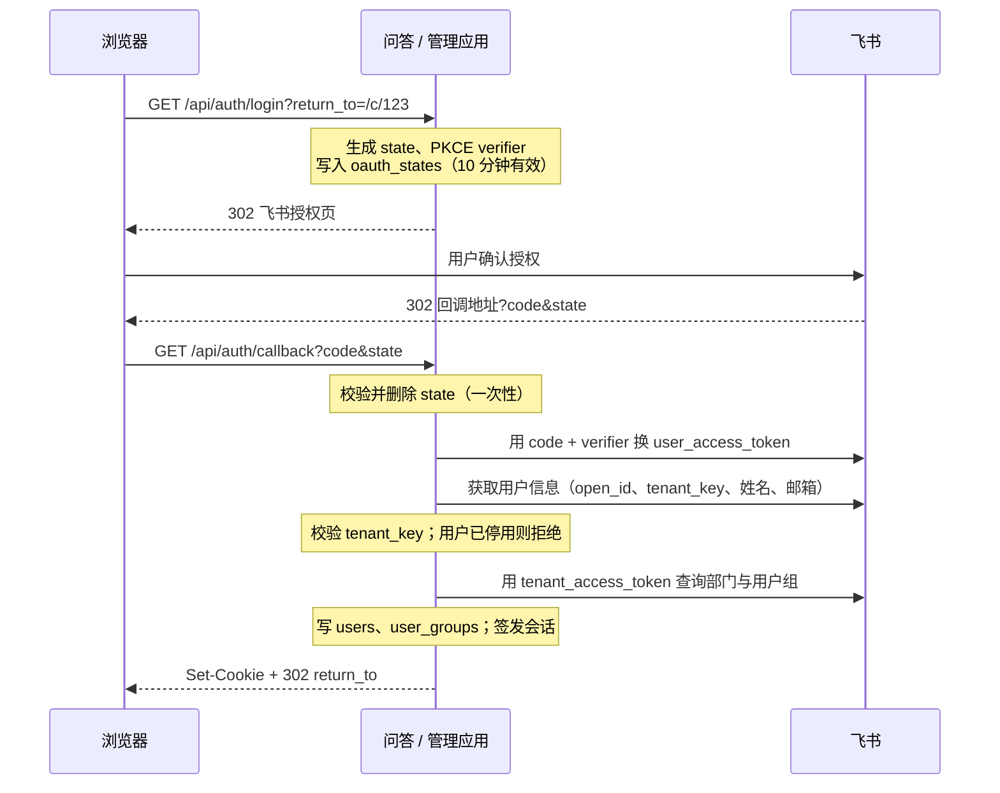
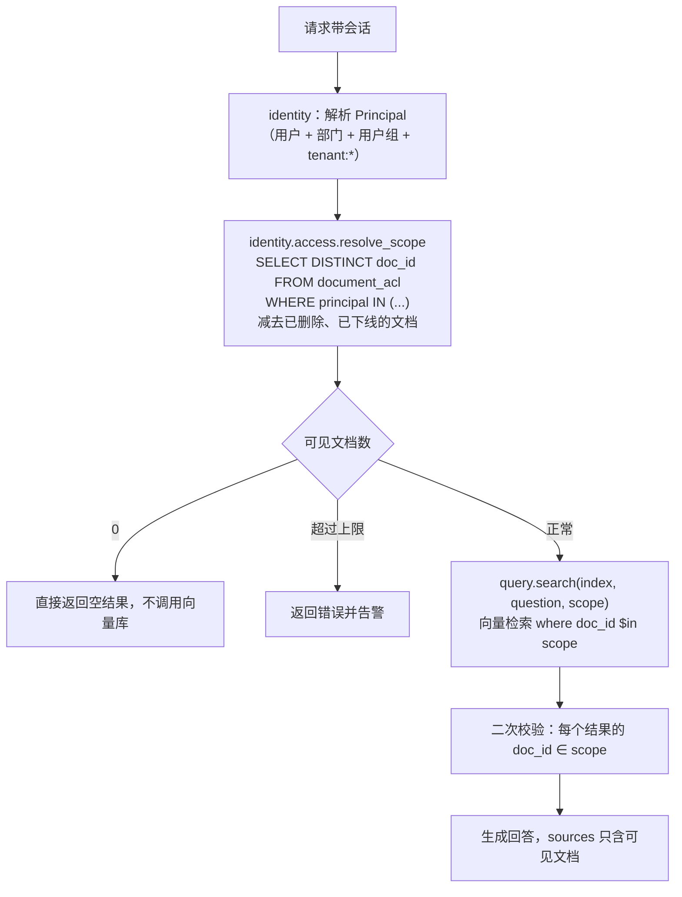

# 身份与权限

- 状态：设计中（未实施）
- 对应规划：[企业知识助手演进路线 · 阶段 2](../规划/企业知识助手演进路线.md)
- 决策记录：[ADR 0010](../adr/0010-用户身份与会话.md)、[ADR 0011](../adr/0011-文档权限模型与检索过滤.md)（提议中）
- 前置依赖：[多数据源接入](./多数据源接入.md)（`data_sources`、迁移框架、飞书自建应用）
- 涉及模块：`auth` `db` `ingest` `query` `api-public` `api-admin` `web-chat` `web-admin` `server` `build`

## 1. 背景

阶段 1 完成后，飞书文档可以同步进知识库，但所有问答用户看到的是同一份内容。阶段 1 方案因此只允许接入测试空间。阶段 2 要做到：**谁在提问，就只能检索到谁在源系统里有权查看的内容**。

现状与差距：

| 位置 | 现状 | 问题 |
| --- | --- | --- |
| 问答端 | 无鉴权，任何能访问端口的人都能提问 | 无法识别用户，也就无法按人过滤 |
| 管理端 | 单一管理员密码，scrypt 存储；内存 token，8 小时过期 | 无法区分人；无法分配角色；重启即掉线；操作无法追溯到人 |
| 暗门 | 前端隐藏入口 + “只监听本机” | 服务端部署后“只监听本机”这道防线不存在 |
| 检索 | `query.search(index, question)` 检索全部内容 | 没有“提问者”这个参数，权限无处落地 |
| import-linter | 问答端禁止依赖 `auth` | 问答端需要登录，但不能顺带获得管理端能力 |

## 2. 目标与非目标

**目标**

- 问答端和管理端都使用企业身份登录（首期为飞书），会话可吊销、可追溯。
- 管理端改为基于角色的访问控制（RBAC），每个接口声明所需权限。
- 文档的可见范围随源系统同步；检索、来源展示、统计等所有出口按提问者过滤，**默认拒绝**。
- 源端撤销权限后，在可预期的时间内生效，并提供紧急下线手段。
- 管理端的写操作留下审计日志。
- 本地模式保持现在的使用体验：不配置 SSO 时，问答免登录，管理端仍用密码。

**非目标**

- 多租户（一套部署服务多个企业）：只服务一个飞书租户，登录时校验 `tenant_key`。
- 细粒度到段落的权限：权限粒度是文档，同一文档的所有块可见范围相同。
- 按数据源划分的知识管理员（“只管自己的空间”）：表结构预留 `scope` 字段，首期只支持全局角色。
- 飞书以外的身份源（企业微信、LDAP、通用 OIDC）：身份源做成接口，首期只实现飞书。
- 用户在 KB Studio 内申请权限：权限以源系统为准，KB Studio 不提供授权入口。

## 3. 威胁模型

| 资产 | 威胁 | 对策 | 章节 |
| --- | --- | --- | --- |
| 受限文档内容 | 普通用户通过提问检索到无权查看的文档 | 检索层强制按访问范围预过滤，没有绕过路径 | 8 |
| 受限文档内容 | 来源片段、文档计数、回归测试结果、缓存、日志泄露内容 | 所有出口统一经过访问范围；日志不记录片段正文 | 8.4 |
| 受限文档内容 | 源端撤销权限后仍可检索 | 权限刷新任务 + 访问版本号让缓存立即失效 + 紧急下线 | 9 |
| 受限文档内容 | 切回旧索引版本后，旧快照的权限复活 | 权限不存进向量库，检索时以元数据库为准 | 8.2 |
| 会话 | 会话 token 被窃取（XSS、日志、URL） | HttpOnly Cookie；库里只存哈希；不出现在 URL 和日志 | 5.3 |
| 会话 | CSRF：诱导已登录用户发起写请求 | SameSite=Lax + 自定义请求头 + Origin 校验 | 5.4 |
| 会话 | 同主机不同端口共享 Cookie，问答会话被拿去访问管理端 | Cookie 分名称，会话绑定应用，服务端校验 | 5.3 |
| 管理能力 | 普通员工登录管理端 | RBAC，未授予角色的用户登录管理端返回 403 | 6 |
| 管理能力 | 离职员工继续使用会话 | 会话定期复核用户状态，停用即吊销全部会话 | 5.5 |
| 管理能力 | 管理员滥用权限后无从追溯 | 审计日志只能追加，接口不提供修改和删除 | 10 |
| 登录流程 | 开放重定向、授权码注入、state 伪造 | `return_to` 只允许站内相对路径；state + PKCE；state 一次性使用 | 5.2 |
| 应急口令 | 暴力破解应急管理员密码 | 默认关闭；只允许本机访问；失败限流与锁定 | 6.3 |

## 4. 整体结构



代码位置：

```text
backend/src/kb_studio/
  identity/                    问答端和管理端都可以依赖；不包含任何管理能力
    principal.py               Principal（当前用户及其全部主体标识）、AccessScope
    providers/
      base.py                  IdentityProvider 协议
      feishu.py                飞书网页应用 OAuth、用户信息、部门与用户组
      local.py                 本地模式的固定用户
    sessions.py                签发、校验、续期、吊销；Cookie 读写
    directory.py               用户、部门、用户组的同步与缓存
    access.py                  resolve_scope(principal) → AccessScope
  auth/                        只有管理应用可以依赖（由 auth.py 改为包）
    rbac.py                    角色、权限点、require_permission
    break_glass.py             应急管理员口令（现有 scrypt 逻辑迁入）
    audit.py                   审计日志写入
  ingest/connectors/feishu/
    permissions.py             读取文档协作者、知识空间成员、链接分享范围
  db/
    users_repo.py  sessions_repo.py  acl_repo.py  roles_repo.py  audit_repo.py
  api/public/auth.py           问答端登录接口
  api/admin/users.py           用户与角色管理
  api/admin/audit.py           审计日志查询
```

## 5. 认证与会话

### 5.1 运行模式

| `KB_AUTH_MODE` | 问答端 | 管理端 | 适用 |
| --- | --- | --- | --- |
| `local`（默认） | 免登录，以固定用户 `local` 身份提问，可见全部文档 | 应急口令登录（即现有的管理员密码） | 本机单人使用，保持现状 |
| `sso` | 必须登录 | SSO 登录，并按角色授权；应急口令默认关闭 | 服务端部署 |

- `local` 模式下，`identity/providers/local.py` 返回的主体拥有 `tenant:*` 和 `local:all`，访问范围为“全部文档”。这是唯一一个可以得到“全部”的入口，`sso` 模式下代码路径不可达（单测覆盖）。
- 启动时校验配置：`sso` 模式缺少 `FEISHU_APP_ID`、`FEISHU_APP_SECRET`、`KB_PUBLIC_CHAT_URL`、`KB_PUBLIC_ADMIN_URL` 中任意一项，拒绝启动；`sso` 模式下 `KB_HOST` 不是本机地址但没有设置 `KB_COOKIE_SECURE=true`，拒绝启动。

### 5.2 飞书登录流程

登录与阶段 1 的同步**必须使用同一个飞书自建应用**：用户标识使用应用维度的 `open_id`，文档权限里的协作者标识也按 `open_id` 读取，两者才能对上。



要点：

- **后端完成全部 OAuth 交互**（BFF 模式）。`user_access_token` 只用于这一次获取用户信息，用完即丢，不落库，也不下发给前端。
- `return_to` 只接受以 `/` 开头、不以 `//` 开头的站内路径，否则一律回到首页，防止开放重定向。
- state 存在服务端 `oauth_states` 表，不放在 Cookie 中，回调时删除，重放无效。
- 部门取用户直属部门，**并展开全部上级部门**。飞书的“共享给某部门”包含其下级部门成员，展开后才能用集合求交做过滤。
- 飞书接口路径、授权页地址和所需权限范围以实施时的开放平台文档为准。所需的应用权限（通讯录只读、用户组只读）在部署说明中列出。

### 5.3 会话

| 项 | 设计 |
| --- | --- |
| 载体 | HttpOnly Cookie；`sso` 模式下加 `Secure`；`SameSite=Lax`；`Path=/` |
| 名称 | 问答 `kb_chat_session`，管理 `kb_admin_session`。**浏览器的 Cookie 不按端口隔离**，同一主机两个端口会互相携带对方的 Cookie，所以名称必须不同，会话还要绑定所属应用 |
| 存储 | `sessions` 表只存 token 的 SHA-256；数据库泄露也无法直接冒用 |
| 有效期 | 问答：空闲 12 小时、最长 7 天；管理：空闲 30 分钟、最长 8 小时。均可用环境变量调整 |
| 续期 | 每次请求刷新空闲时间，但最多每分钟写一次库，避免每个请求都写 |
| 轮换 | 登录成功后总是签发新 token，旧的同名 Cookie 对应的会话一并吊销，防止会话固定攻击 |
| 吊销 | 退出、用户停用、角色变更（管理端会话）时吊销；服务重启不影响会话 |
| 推荐部署 | 问答与管理使用不同主机名（如 `kb.example.com`、`kb-admin.intranet.example.com`），而不是同一主机的两个端口 |

管理端现有的 `Authorization: Bearer` + sessionStorage 方案在两种模式下都改为 Cookie 会话。前端不再接触 token，401 处理逻辑保留。

### 5.4 CSRF 与跨域

Cookie 会话需要防 CSRF。三道检查都在服务端中间件中完成，对所有非 GET 请求生效：

1. `SameSite=Lax`：跨站的 POST 请求不携带 Cookie。
2. 要求请求头 `X-KB-Request: 1`。带自定义请求头的跨站请求必须先通过 CORS 预检，而服务端不对其他源放行。这一条同时覆盖了 `multipart/form-data` 上传：它属于“简单请求”，不会触发预检，只靠 Content-Type 防不住。
3. 校验 `Origin`（缺失时退回 `Referer`）必须在 `KB_ALLOWED_ORIGINS` 中。

前端 `shared` 的 HTTP 客户端工厂统一加上请求头，SSE 请求同样适用（问答使用 `fetch` 读取流，本来就是 POST）。

### 5.5 用户状态复核

- 会话每 1 小时（`KB_IDENTITY_RECHECK_MIN`）用 `tenant_access_token` 复核一次用户状态，同时刷新部门和用户组。复核失败（网络异常）时沿用缓存，最多容忍 24 小时；用户已停用或离职时，立即吊销其全部会话。
- 另有一个每日任务，批量复核 30 天内登录过的用户，处理“离职后再也没访问过”的情况。

## 6. 角色与授权

### 6.1 角色与权限点

权限点在代码中定义，角色到权限点的映射也在代码中定义，不允许在界面上自定义角色。数据库只保存“谁拥有哪个角色”。

| 权限点 | 说明 | 系统管理员 `admin` | 知识管理员 `knowledge_manager` | 普通用户 `member` |
| --- | --- | :-: | :-: | :-: |
| `chat:use` | 问答 | ✓ | ✓ | ✓ |
| `admin:access` | 登录管理端 | ✓ | ✓ | |
| `docs:read` | 文档列表、版本历史 | ✓ | ✓ | |
| `docs:write` | 上传、删除、回退、重新入库、设置上传文档的可见范围 | ✓ | ✓ | |
| `sources:manage` | 数据源增删改、同步、权限刷新 | ✓ | ✓ | |
| `indexes:manage` | 重建、切换、删除索引 | ✓ | ✓ | |
| `eval:manage` | 回归用例与评测 | ✓ | ✓ | |
| `eval:impersonate` | 以指定主体运行回归用例、查看其检索片段 | ✓ | | |
| `settings:write` | 运行参数 | ✓ | ✓ | |
| `docs:block` | 紧急下线文档 | ✓ | ✓ | |
| `users:manage` | 授予与撤销角色 | ✓ | | |
| `audit:read` | 查看审计日志 | ✓ | | |

- `member` 不需要授予：同租户的已登录用户默认拥有。配置了 `KB_CHAT_ALLOWED_GROUPS` 时，只有这些部门或用户组的成员可以使用问答。
- 管理接口统一改为 `Depends(require_permission("docs:write"))`，路由级别默认要求 `admin:access`。新接口不声明权限点时，单测失败（扫描路由表）。

### 6.2 初始管理员

- `KB_BOOTSTRAP_ADMINS`：逗号分隔的邮箱或 `open_id`。这些用户首次登录时自动授予 `admin`，并写审计日志。只在“系统中还没有任何 admin”时生效，防止配置被篡改后静默提权。
- 运维命令 `kb-studio grant-role <email> admin`：用于 bootstrap 配错或管理员全部离职的情况，需要服务器权限才能执行。

### 6.3 应急口令

现有的管理员密码保留为应急入口（break-glass），用于 SSO 故障：

- `local` 模式下就是现在的登录方式，行为不变。
- `sso` 模式下默认关闭；`KB_ADMIN_BREAK_GLASS=true` 时开启，且只接受来自本机回环地址的请求。
- 同一来源 IP 15 分钟内失败 5 次，锁定 15 分钟。
- 每次使用都写审计日志，并在管理端顶部持续提示“当前为应急登录”。
- 应急登录的主体固定为 `break_glass`，拥有 `admin` 角色，但**问答端访问范围为空**：应急登录只用于修复系统，不能用来读文档。

### 6.4 暗门入口

暗门保留为“从问答页跳到管理端”的快捷方式。`sso` 模式下默认关闭（`VITE_SECRET_ENTRY=false`），改为在用户菜单中对拥有 `admin:access` 的用户显示“管理后台”入口。入口是否可见不影响安全，真正的访问控制在管理端接口上。

## 7. 文档权限模型

### 7.1 主体标识

文档的可见范围是一个主体标识的集合；用户的身份展开成另一个主体标识的集合；**两个集合有交集即可见**。

| 主体标识 | 含义 | 用户侧来源 |
| --- | --- | --- |
| `tenant:*` | 本租户全体成员 | 所有已登录用户 |
| `user:<open_id>` | 某个用户 | 用户本人 |
| `dept:<open_department_id>` | 某个部门（含下级部门） | 直属部门及其全部上级部门 |
| `group:<group_id>` | 飞书用户组 | 所属用户组 |
| `local:all` | 本地模式专用 | 仅 `local` 模式的固定用户 |

主体标识只是字符串，新增身份源时加前缀即可，过滤逻辑不变。

### 7.2 各来源的可见范围

| 来源 | 可见范围的取值 |
| --- | --- |
| 飞书知识库 | 文档协作者 ∪ 知识空间成员（节点继承空间权限时）∪ 链接分享范围（“组织内获得链接可阅读”记为 `tenant:*`）。协作者为部门、用户组时直接映射为对应主体 |
| 手动上传 | 上传时由知识管理员选择：全员可见，或指定部门、用户组、用户；之后可以修改。迁移时已有文档设为全员可见 |
| 本地目录 | 数据源级别统一配置，默认全员可见（本地目录只用于本地模式） |
| 其他新来源 | 连接器提供则使用连接器提供的，否则使用数据源的默认可见范围；**两者都没有时为空，即任何人都不可见** |

飞书的有效权限计算比较复杂（节点是否继承空间权限、外部协作者、密级标签），实施前要用测试空间逐项验证。验证不通过的情形一律按“更严格”处理，并在同步记录中列出。

### 7.3 默认拒绝

- 可见范围为空的文档，问答端任何人都检索不到；知识管理员在后台可以看到，并带有“无人可见”标记。
- 某篇文档的权限读取失败时，可见范围置空、`acl_status = error`，同步记录中写明原因；不沿用旧值。旧值可能已经过期，宁可暂时不可见，也不能误放行。
- 外部协作者（其他租户的用户）忽略，不进入可见范围。

### 7.4 连接器接口扩展

阶段 1 已经约定权限信息在阶段 2 加入，这里不改已有接口，只新增一个可选能力：

```python
@dataclass(frozen=True)
class SourceAcl:
    principals: frozenset[str]      # 已经映射好的主体标识
    complete: bool                  # False 表示部分权限读取失败，引擎按 7.3 处理


class AclCapable(Protocol):
    def fetch_acl(self, ref: SourceRef) -> SourceAcl: ...
```

- 同步引擎在取回内容后调用 `fetch_acl`；对哈希未变化的文档同样调用，因为权限可能单独变化。
- 可见范围的哈希 `acl_hash` 与内容哈希分开存储。**权限变化不产生新版本，也不重新向量化**，只更新 `document_acl`。

## 8. 检索时过滤

### 8.1 方案对比

| 方案 | 做法 | 优点 | 问题 |
| --- | --- | --- | --- |
| A. 检索后过滤 | 先检索 top_k，再剔除无权文档 | 简单 | 有权限的结果被挤出 top_k，召回率随权限收窄而下降；无权文档仍参与了排序 |
| B. 块元数据预过滤 | 入库时把可见范围写进块元数据（Chroma 1.5 支持数组和 `$contains`），检索时按用户主体做 `$or` | 向量库原生过滤，规模大时性能好 | 权限变化要改写所有块的元数据；**旧索引快照保存的是旧权限，切回旧版本后撤销的权限会复活** |
| C. 按文档集合预过滤 | 先在元数据库中算出用户可见的 `doc_id` 集合，检索时传入 `where doc_id $in [...]` | 权限永远以元数据库为准；权限变化只改一张表；新旧索引版本都适用 | 可见文档数很大时，`$in` 列表很长 |

**采用 C**。理由：

- 与蓝绿切换模型兼容。B 方案下，“切回旧索引”这一常规操作本身就会造成权限泄露，必须在每次切换时改写全部元数据才能补救。
- 当前规模（单租户、文档数千篇以内）下，`$in` 列表的开销可以接受。
- 迁移到 Postgres + pgvector 后（见[服务端部署](./服务端部署.md)），C 方案自然演变为一次 SQL JOIN，过滤逻辑不变。

容量边界：单个用户可见文档数超过 `KB_ACL_INLINE_LIMIT`（默认 5000）时，问答返回明确的错误，并触发告警。这个数字是迁移存储的触发条件之一，不做静默降级。

### 8.2 执行流程



- **二次校验**是纵深防御：防止向量库过滤条件写错、或某个检索路径（阶段 3 的关键词检索）遗漏过滤。校验失败的结果直接丢弃，并记录安全告警日志（只记 `doc_id`，不记正文）。
- 访问范围按 `(user_id, acl_epoch)` 在进程内缓存 60 秒。`acl_epoch` 是 `kv` 中的一个计数器，任何 `document_acl`、文档状态、用户组变化都会让它加一，缓存因此立即失效。

### 8.3 强制经过访问范围

权限漏洞往往来自“新加的接口忘了过滤”，所以用代码结构保证没有绕过路径：

- `query.search(index, question, scope: AccessScope)` 中 `scope` 是必填参数，没有默认值。
- `AccessScope` 只能由 `identity.access` 构造：`for_principal(principal)`（问答端）、`for_eval(principals)`（回归测试）。不提供“全部可见”的公开构造方式；`local` 模式通过 `for_principal` 自然得到全部文档。
- import-linter 新增契约：`api.public` 和 `evaluation` 不得直接依赖 `rag`（检索必须经过 `query`）。
- 单测：遍历问答端所有返回文档信息的接口，用一个“只能看到 1 篇文档”的用户验证不会出现其他文档的任何信息。

### 8.4 其他出口

| 出口 | 处理 |
| --- | --- |
| `sources` 事件 | 只来自已过滤的检索结果；`source_url` 也只对可见文档返回 |
| `/api/status` 的文档数 | 改为当前用户可见的文档数；不再返回全库数量 |
| 回归测试 | 用例增加 `principals` 字段（默认 `["tenant:*"]`），按指定主体检索，可以写“某部门不应看到某文档”的权限用例；设置为其他主体需要 `eval:impersonate` |
| 管理端文档列表 | 知识管理员可以看到全部文档的标题和元数据（管理需要）；回归测试结果中的片段正文按 `eval:impersonate` 权限控制 |
| 日志 | 问答日志记录 `user_id`、`doc_id`、分数，不记录问题原文以外的片段正文 |
| 阶段 4 的会话历史 | 会话数据在独立的会话服务中，不做权限判断；问答应用读取历史后按当前权限重新校验来源，已无权查看的显示为“该来源已无权查看” |

## 9. 权限变更与时效

| 场景 | 生效路径 | 时效 |
| --- | --- | --- |
| 源端调整文档协作者或分享范围 | 权限刷新任务：只列举并读取权限，不取回正文 | `acl_refresh_interval_min`，默认 15 分钟，最小 5 分钟 |
| 用户换部门、退出用户组 | 会话复核时刷新 `user_groups` | 最长 1 小时 |
| 用户离职、停用 | 会话复核发现后吊销全部会话；每日任务兜底 | 最长 1 小时 |
| 紧急情况（误同步了敏感文档） | 管理端“紧急下线”：文档 `blocked = 1`，所有人立即不可见；可以批量操作，可以按数据源一键下线 | 立即（`acl_epoch` 加一） |
| 后台手动修改上传文档的可见范围 | 直接写 `document_acl` | 立即 |

- 权限刷新与内容同步分开调度：权限变化通常比内容变化更紧急，而只读权限的接口调用成本低得多。
- 紧急下线不删除文档，也不改源端，解除下线需要同样的权限点并写审计日志。

## 10. 审计日志

| 字段 | 说明 |
| --- | --- |
| `at`、`request_id` | 时间与请求 ID，可以和应用日志关联 |
| `actor_user_id`、`actor_name`、`actor_kind` | 操作人；`actor_kind` 区分 `user`、`break_glass`、`system`（定时任务） |
| `app`、`ip`、`user_agent` | 来源 |
| `action` | 如 `auth.login`、`role.grant`、`document.delete`、`index.activate`、`source.sync`、`settings.update`、`document.block` |
| `target_type`、`target_id` | 操作对象 |
| `detail` | JSON：修改前后的差异（运行参数）、批量操作的 id 列表等；**不记录密码、token、文档正文** |
| `result` | `success` / `denied` / `failed` |

- 只有写入接口，没有修改和删除接口；数据库层面在迁移到 Postgres 后用单独的账号和权限进一步保证。
- 默认保留 365 天（`KB_AUDIT_RETENTION_DAYS`），由每日任务清理。
- 登录失败、权限不足（403）也记录，用于发现探测行为。
- 问答内容不进审计日志，属于阶段 4 的会话数据，单独管理。

## 11. 边界契约调整

“问答端只读”的含义需要明确为**对知识库只读**：问答端可以写入属于用户自己的数据（会话、以后的对话记录与反馈），但不能改变任何文档、索引、权限、设置。

| 契约 | 调整 |
| --- | --- |
| 分层 | 新增 `identity` 层：`cli → apps → api → ingest \| auth → evaluation → query → identity → rag \| db \| storage → settings` |
| 问答端只读 | 禁止列表不变（`api.admin`、`auth`、`ingest`、`evaluation`、`storage`）；`identity` 不在禁止列表中。契约名称改为“问答端对知识库只读” |
| 新增：检索必经 query | `api.public`、`evaluation` 不得直接依赖 `rag` |
| 新增：identity 不含管理能力 | `identity` 不得依赖 `auth`（由分层契约自然保证，单独列出便于理解） |

- `identity` 中可以写库的只有 `users`、`user_groups`、`sessions`、`oauth_states` 四张表，由代码评审和单测（扫描 `identity` 中的 SQL 写语句）保证。
- 按项目规则，修改 `backend/pyproject.toml` 的契约之前，必须先采纳 ADR 0010。

## 12. 数据模型与迁移

迁移框架沿用阶段 1 的 `PRAGMA user_version`，本阶段为迁移 2。

```sql
CREATE TABLE users (
    id            INTEGER PRIMARY KEY AUTOINCREMENT,
    provider      TEXT NOT NULL,             -- feishu / local / break_glass
    subject       TEXT NOT NULL,             -- 飞书 open_id
    name          TEXT NOT NULL,
    email         TEXT,
    status        TEXT NOT NULL,             -- active / disabled
    last_login_at TEXT,
    checked_at    TEXT,                      -- 最近一次状态复核
    created_at    TEXT NOT NULL,
    UNIQUE (provider, subject)
);

CREATE TABLE user_groups (                   -- 用户展开后的部门与用户组主体，复核时整体替换
    user_id   INTEGER NOT NULL REFERENCES users(id),
    principal TEXT NOT NULL,                 -- dept:xxx / group:xxx
    PRIMARY KEY (user_id, principal)
);

CREATE TABLE user_roles (
    user_id    INTEGER NOT NULL REFERENCES users(id),
    role       TEXT NOT NULL,                -- admin / knowledge_manager
    scope      TEXT NOT NULL DEFAULT '*',    -- 预留：source:<id>，首期只用 *
    granted_by INTEGER REFERENCES users(id),
    granted_at TEXT NOT NULL,
    PRIMARY KEY (user_id, role, scope)
);

CREATE TABLE sessions (
    token_hash      TEXT PRIMARY KEY,
    user_id         INTEGER NOT NULL REFERENCES users(id),
    app             TEXT NOT NULL,           -- chat / admin
    created_at      TEXT NOT NULL,
    last_seen_at    TEXT NOT NULL,
    expires_at      TEXT NOT NULL,           -- 绝对过期时间
    revoked_at      TEXT,
    ip              TEXT,
    user_agent      TEXT
);

CREATE TABLE oauth_states (
    state         TEXT PRIMARY KEY,
    code_verifier TEXT NOT NULL,
    app           TEXT NOT NULL,
    return_to     TEXT NOT NULL,
    expires_at    TEXT NOT NULL
);

CREATE TABLE document_acl (
    doc_id    INTEGER NOT NULL REFERENCES documents(id),
    principal TEXT NOT NULL,
    PRIMARY KEY (doc_id, principal)
);
CREATE INDEX idx_document_acl_principal ON document_acl(principal);

CREATE TABLE audit_logs (
    id            INTEGER PRIMARY KEY AUTOINCREMENT,
    at            TEXT NOT NULL,
    request_id    TEXT,
    actor_user_id INTEGER,
    actor_name    TEXT,
    actor_kind    TEXT NOT NULL,
    app           TEXT NOT NULL,
    ip            TEXT,
    user_agent    TEXT,
    action        TEXT NOT NULL,
    target_type   TEXT,
    target_id     TEXT,
    detail        TEXT NOT NULL DEFAULT '{}',
    result        TEXT NOT NULL
);
CREATE INDEX idx_audit_logs_at ON audit_logs(at);
```

`documents` 增加列：`acl_hash TEXT`、`acl_status TEXT NOT NULL DEFAULT 'ok'`、`blocked INTEGER NOT NULL DEFAULT 0`。`data_sources` 增加 `default_acl TEXT`（JSON 数组）和 `acl_refresh_interval_min INTEGER`。

迁移步骤：

1. 按阶段 1 的约定先备份 `app.db`。
2. 建表、加列。
3. 已有文档全部写入 `(doc_id, 'tenant:*')`，即保持“所有人可见”的现状。
4. 现有的 `kv.admin_password_hash` 原样保留，作为应急口令。
5. 写入 `user_version = 2`。

向量库不需要迁移，也不需要重建索引：权限完全保存在元数据库中（8.1 方案 C）。

## 13. 接口与前端

### 13.1 问答端（`api-public`）

| 方法与路径 | 说明 |
| --- | --- |
| `GET /api/auth/me` | 当前用户（姓名、头像、是否有管理端权限）；`local` 模式返回固定用户；未登录返回 401 |
| `GET /api/auth/login?return_to=` | 跳转到飞书授权页 |
| `GET /api/auth/callback` | 授权回调，设置 Cookie 后跳转 |
| `POST /api/auth/logout` | 吊销当前会话 |
| `POST /api/chat`、`GET /api/status` | `sso` 模式下要求登录；按访问范围过滤（见 8.4） |

### 13.2 管理端（`api-admin`）

| 方法与路径 | 说明 |
| --- | --- |
| `GET /api/admin/auth/me`、`/login`、`/callback`、`POST /logout` | 与问答端相同，会话绑定 `admin` |
| `POST /api/admin/auth/break-glass` | 应急口令登录，见 6.3；替代现有的 `/login` 密码登录（**破坏性**，`local` 模式下前端同步修改） |
| `GET /api/admin/users?keyword=` | 登录过的用户及其角色 |
| `PUT /api/admin/users/{id}/roles` | 设置角色；不能撤销自己的 `admin`；至少保留一个 `admin` |
| `GET /api/admin/audit-logs` | 分页，按时间、操作人、动作、结果筛选 |
| `PUT /api/admin/documents/{id}/acl` | 设置上传文档的可见范围；同步来源的文档返回 400 |
| `POST /api/admin/documents/block` · `/unblock` | 批量紧急下线、解除 |
| `POST /api/admin/sources/{id}/acl-refresh` | 立即刷新权限 |

文档列表返回中增加 `visibility`（`all` / `restricted` / `none`）、`acl_status`、`blocked`；详情接口返回完整的主体列表及其显示名称。

### 13.3 前端

| 位置 | 改动 |
| --- | --- |
| `web-shared` | HTTP 客户端统一携带 `X-KB-Request` 请求头，`credentials: "include"`；移除 token 注入 |
| `web-chat` | 启动时请求 `/api/auth/me`，401 时跳转登录；顶部显示用户菜单（退出、有权限时显示“管理后台”）；`local` 模式不显示 |
| `web-admin` 登录页 | `sso` 模式下只有“飞书登录”按钮；`local` 模式下是现在的密码登录；应急登录时顶部常驻提示 |
| `web-admin` 菜单 | 按 `/auth/me` 返回的权限点显示菜单和按钮；无权限的接口仍以后端为准 |
| `web-admin` 新页面 | “用户与角色”“审计日志” |
| `web-admin` 文档列表 | 增加“可见范围”列和“无人可见”“已下线”标记；上传时选择可见范围；勾选后“紧急下线” |

## 14. 测试与验证

**单元测试**（不调用真实飞书接口，用 `httpx.MockTransport`）

| 对象 | 覆盖内容 |
| --- | --- |
| 登录流程 | state 一次性使用、过期、篡改；PKCE；`return_to` 开放重定向用例集；外部租户被拒绝；停用用户被拒绝 |
| 会话 | 只存哈希；空闲与绝对过期；每分钟最多写一次；登录轮换；问答会话访问管理端被拒绝 |
| CSRF | 缺少请求头、错误 Origin、multipart 跨站请求均返回 403 |
| RBAC | 路由表扫描：每个管理接口都声明了权限点；角色矩阵逐项验证；不能撤销最后一个 admin |
| 访问范围 | 主体展开（含上级部门）；默认拒绝；`blocked` 文档排除；`acl_epoch` 让缓存失效；`sso` 模式下无法得到“全部”范围 |
| 检索过滤 | 构造多个用户和文档，验证 `sources`、`status`、回归测试的结果互不泄露；向量库返回越权结果时二次校验能拦截 |
| 飞书权限映射 | 协作者、空间成员、链接分享、外部协作者、读取失败等情形的快照测试 |
| 迁移 | 旧库迁移后所有文档为 `tenant:*`；应急口令可用；重复执行幂等 |

**端到端验证**（隔离的 `KB_DATA_DIR` 和端口，飞书测试租户）

1. 用两个测试账号（不同部门）登录问答端，分别提问同一个只共享给其中一个部门的文档，确认另一个账号检索不到，`/api/status` 文档数不同。
2. 在飞书中撤销某账号的文档权限，手动触发权限刷新，确认立即不可见。
3. 切回一个旧的索引版本，重复第 1 步，确认权限仍然正确。
4. 停用一个测试账号，确认其会话在复核周期内失效。
5. 紧急下线一篇文档，确认所有账号立即不可见，审计日志有记录。

## 15. 实施顺序与待确认事项

| 步骤 | 内容 | 可单独验收 |
| --- | --- | --- |
| 1 | `identity` 层与契约调整；会话改为 Cookie；`local` 模式行为不变 | 现有功能不变，检查全部通过 |
| 2 | 飞书登录；`users`、`sessions`；问答端在 `sso` 模式下要求登录 | 测试租户账号可以登录问答端 |
| 3 | RBAC、bootstrap、用户与角色页面、应急口令改造、审计日志 | 不同角色看到不同菜单，越权接口返回 403 |
| 4 | `document_acl`、访问范围、检索过滤、二次校验、上传文档的可见范围 | 上传文档设为部门可见后，其他部门检索不到 |
| 5 | 飞书权限同步、权限刷新任务、紧急下线 | 第 14 节端到端验证全部通过 |

待确认事项：

| 事项 | 建议 | 说明 |
| --- | --- | --- |
| 检索过滤方案 | **已确认（2026-10-23）**：权限只存元数据库，不进块元数据；方案 C（按文档集合预过滤） | 与蓝绿切换兼容；规模上限 5000 篇/用户，超过即迁移存储 |
| 管理端会话改为 Cookie | 两种模式都改 | 统一实现；`local` 模式的使用体验不变 |
| 知识管理员能否看到全部文档标题 | 可以看标题和元数据，不能看受限片段正文 | 管理需要知道有哪些文档；正文按 `eval:impersonate` 控制 |
| 权限刷新默认间隔 | 15 分钟 | 越短越安全，飞书接口调用量越大；紧急情况用“紧急下线” |
| 应急口令在 `sso` 模式下默认关闭 | 关闭，且只允许本机访问 | 开启后每次使用都审计 |
| 规划中“暗门可作为本地模式入口保留” | 保留；`sso` 模式下默认关闭，改为用户菜单入口 | 与规划一致 |
