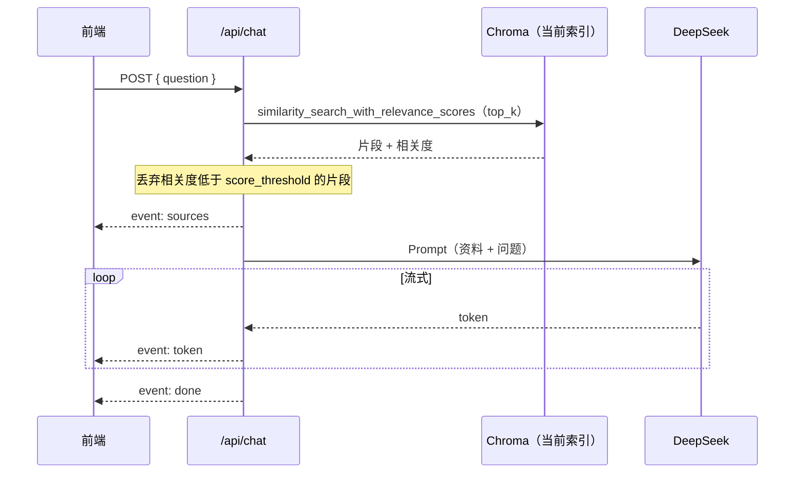
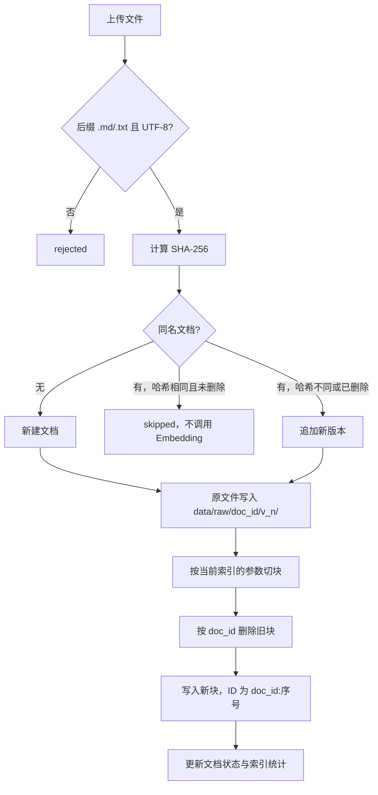
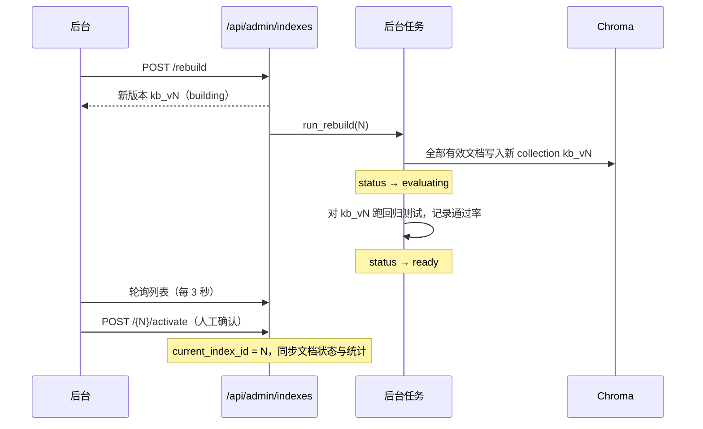

# 架构设计

## 定位

KB Studio 是一个跑在本机的知识库问答客户端，目的是在不部署服务器的前提下，把工程化 RAG 的完整链路走一遍：

- **问答**：检索 → 相关度过滤 → 生成回答，流式输出并标注来源
- **知识库管理**：文档版本、增量入库、软删除、文档级回退
- **索引管理**：按参数构建索引版本，蓝绿切换，索引级回退
- **质量保障**：回归测试用例，作为切换索引前的参考

## 技术栈

| 层 | 选型 | 说明 |
| --- | --- | --- |
| 后端框架 | FastAPI + uvicorn | 只监听 `127.0.0.1:8765` |
| RAG | LangChain 1.x | `init_chat_model`、`ChatPromptTemplate`、文本切分器 |
| 对话模型 | DeepSeek `deepseek-flash` | 关闭思考模式（`extra_body.thinking.disabled`） |
| Embedding | 阿里百炼 `text-embedding-v4` | 走 OpenAI 兼容接口，可在后台改为 qwen3.7 系列 |
| 向量库 | Chroma（本地持久化） | 余弦距离，每个索引版本一个 collection |
| 元数据库 | SQLite（标准库 `sqlite3`） | 不引入 ORM |
| 前端 | Vue 3 + Vite + TS + Naive UI + Tailwind v4 + Pinia | 规范与 `eliauk-music-tauri-rust` 一致 |
| 包管理 | uv（Python）、pnpm（前端） | |

## 进程模型

问答与管理是两个独立的应用，前后端都在代码和网络两个层面隔离（[ADR 0007](./adr/0007-应用边界与可拆分部署.md)）：

```
┌──── 问答前端 index.html ────┐        ┌──── 管理前端 admin.html ────┐
│  问答页 · 暗门只负责跳转     │ ─URL─▶ │  登录页 · 后台四个页面       │
└──────────────┬──────────────┘        └──────────────┬──────────────┘
               │ HTTP / SSE                            │ HTTP（Bearer token）
               ▼                                       ▼
┌── 问答应用 chat_app :8765 ──┐        ┌── 管理应用 admin_app :8766 ──┐
│  /api/chat  /api/status      │        │  /api/admin/*                 │
│  只读，经由 query 层访问     │        │  ingest · evaluation · auth   │
└──────────────┬──────────────┘        │  BackgroundTasks：重建 + 评估 │
               │                        └──────────────┬───────────────┘
               └───────────────┬──────────────────────┘
                               ▼
        data/app.db（SQLite） · data/raw/（原文件） · data/chroma/（向量库）
                               │
                               └──▶ DeepSeek API · 百炼 Embedding API
```

| 运行方式 | 命令 | 说明 |
| --- | --- | --- |
| 本地默认 | `uv run kb-studio` | 两个应用在**同一进程**、不同端口运行，共享本地 Chroma 客户端 |
| 分进程部署 | `kb-studio-chat` + `kb-studio-admin` | 必须设置 `KB_CHROMA_URL` 使用 Chroma 服务端；本地 PersistentClient 不支持多进程同时读写 |
| 前端开发 | `pnpm dev`（5174） | 同一个 Vite 服务提供两个入口页；`/api/admin` 代理到 8766，其余 `/api` 代理到 8765 |

- 每个应用只托管自己的入口页：问答端口访问不到 `admin.html` 和 `/api/admin/*`，管理端口也没有问答接口。
- 生产构建时两个入口分别打包，共享代码拆成公共 chunk。
- 部署相关配置全部可以用环境变量覆盖：`KB_HOST`、`KB_CHAT_PORT`、`KB_ADMIN_PORT`、`KB_DATA_DIR`、`KB_CHROMA_URL`、`KB_FRONTEND_DIST`；前端构建时可设置 `VITE_CHAT_URL`、`VITE_ADMIN_URL`、`VITE_SECRET_ENTRY`。

## 数据分层

工程化 RAG 一般把数据分成三层，本项目一一对应：

```
原始数据（真相源）          元数据库（登记表）               向量库（派生索引）
data/raw/<doc_id>/v<n>/  →  data/app.db                  →  data/chroma/
每个版本单独一个目录          文档、版本、索引版本、           kb_v1、kb_v2 …
旧版本不覆盖，可以回退         运行参数、回归用例                可以由前两层重新构建
```

- **原始数据才是真相源**。向量库只是派生出来的索引，坏了、丢了，都能用“重建索引”从原始数据重新生成。
- 删除 `data/` 目录，就恢复到全新状态。

| 工程化角色 | 生产常见选型 | 本项目 |
| --- | --- | --- |
| 对象存储 | OSS / S3（开启版本控制） | `data/raw/<doc_id>/v<n>/` |
| 元数据库 | MySQL / PostgreSQL | SQLite |
| 向量库 | Milvus / Qdrant / ES | Chroma |
| 索引别名 | collection alias | `kv.current_index_id` |
| 异步任务 | Celery / MQ | FastAPI BackgroundTasks |
| 质量门槛 | 评估流水线 | 回归用例 + 关键词判定 |

## 后端模块

```
backend/src/kb_studio/
├── cli.py               启动命令：kb-studio（同进程双端口）、kb-studio-chat、kb-studio-admin
├── settings.py          路径、端口、模型名、运行参数默认值，部署项可由环境变量覆盖
├── apps/                应用组装：chat_app、admin_app，公共的生命周期与入口页托管在 common
├── api/public/          问答端接口：只读
├── api/admin/           管理端接口：鉴权、文档、索引、评估、设置
├── auth.py              管理员密码（scrypt）与内存 token，依赖项 require_admin
├── ingest/              写入链路：增量入库、索引状态、全量重建
├── evaluation/          回归测试执行与判定
├── query/               只读查询：解析当前索引、按运行参数检索与生成，问答端和评估共用
├── rag/                 RAG 能力：模型工厂、切分、向量库客户端、检索与回答
├── db/                  SQLite 表结构与各表读写（repo）
└── storage/             原文件落盘
```

依赖方向是单向的，由 import-linter 在 `scripts/check.sh` 中强制检查（契约定义在 `backend/pyproject.toml`）：

```
cli → apps → api → ingest | auth → evaluation → query → rag | db | storage → settings
```

| 契约 | 内容 |
| --- | --- |
| 分层 | 上层可以依赖下层，下层不能反向依赖 |
| 问答端只读 | `api.public` 和 `apps.chat_app` 不得依赖（含间接依赖）`api.admin`、`auth`、`ingest`、`evaluation`、`storage` |
| 应用独立 | `api.public` 与 `api.admin`、`apps.chat_app` 与 `apps.admin_app` 互相不引用 |

| 模块 | 职责 | 关键函数 |
| --- | --- | --- |
| `query/service.py` | 解析当前索引；按运行参数检索、生成回答、转换来源；问答与评估共用同一条链路 | `get_current_index`、`search`、`answer` |
| `rag/models.py` | 创建对话模型和 Embedding 实例；处理百炼兼容参数 | `get_chat_model`、`get_embeddings` |
| `rag/splitter.py` | 先按 Markdown 标题、再按长度切块，生成稳定的块 ID | `split_text`、`build_chunks`、`chunk_id` |
| `rag/vectorstore.py` | 创建 Chroma 客户端（本地或服务端）；按索引版本获取 collection；按文档删块；删除 collection | `get_store`、`delete_doc_chunks`、`drop_collection` |
| `rag/qa.py` | Prompt、检索加阈值过滤、生成回答（流式与非流式） | `retrieve`、`stream_answer`、`answer` |
| `ingest/incremental.py` | 上传、判断是否变化、版本化、单文档入库、删除、回退 | `decide_action`、`upload_document`、`index_document` |
| `ingest/index_state.py` | 首次自动建索引、切换、删除、同步统计和文档状态 | `ensure_current_index`、`activate`、`sync_documents_with_index` |
| `ingest/rebuild.py` | 按当前参数全量构建新的索引版本，构建完跑回归测试 | `start_rebuild`、`run_rebuild` |
| `evaluation/runner.py` | 逐条用例检索并回答，按规则判定是否通过 | `run_eval`、`judge` |

## 数据模型

| 表 | 关键字段 | 说明 |
| --- | --- | --- |
| `documents` | `filename`（唯一）、`current_version`、`content_hash`、`status`、`chunk_count`、`error` | 文档登记表。**用文件名识别同一文档** |
| `document_versions` | `(doc_id, version)`、`content_hash`、`raw_path` | 每次内容变化追加一行，原文件路径指向 `data/raw/` |
| `index_versions` | `collection`（`kb_v{id}`）、`embedding_model`、`chunk_size`、`chunk_overlap`、`status`、`eval_pass_rate` | 索引版本。**构建参数随版本固化**，后续增量入库沿用该版本自己的参数 |
| `kv` | `current_index_id`、`admin_password_hash`、`runtime_settings` | 全局状态与运行参数 |
| `eval_cases` | `question`、`expected_keywords`（JSON）、`should_refuse` | 回归用例，首次启动时写入 6 条种子数据 |

向量库中每个块的元数据：`doc_id`、`version`、`source`（文件名）、`section`（标题路径，如 `员工手册 > 假期制度 > 年假`）。块 ID 固定为 `{doc_id}:{序号}`。

### 状态机

**文档状态**（`documents.status`，以**当前索引**为准）：

```
上传 / 回退 / 重新入库 ──▶ pending ──入库成功──▶ indexed
                            │
                            └──入库失败──▶ failed（error 字段记录原因，可点“重新入库”重试）

删除 ──▶ deleted（软删除：原文件和版本保留，重新上传同名文件即恢复）

切换索引 ──▶ 按新索引里实际存在的块重新计算：
            块不存在或版本不一致 → pending（error 字段说明原因）
            版本一致 → indexed
```

**索引状态**（`index_versions.status`）：

```
building ──构建成功──▶ evaluating ──回归测试结束（无论成败）──▶ ready
    │
    └──构建失败──▶ failed（删除不完整的 collection，记录 error）
```

只有 `ready` 状态的版本可以“设为当前”或删除；当前正在使用的版本不能删除。

## 核心流程

### 问答



- 没有命中任何片段时，仍会调用模型，资料部分是“未检索到相关资料”。Prompt 约束模型回答“没有找到”，或者对身份类问题简短作答，都不标注来源。
- 流开始后状态码已经发出去了，之后再出错只能通过 `event: error` 告知前端。
- 前端用 `fetch` 读取流，因为 `EventSource` 只支持 GET。`utils/sse.ts` 负责处理网络分包时一个事件被拆在两段数据里的情况。
- 回答的原文按 token 拼接后保存，不做修改；展示时经过渲染管线生成 HTML，见「前端结构 · 模型输出渲染」。

### 上传与增量入库



- **只影响这一个文档**，其他文档的块和更新时间都不变。
- 第一次上传时还没有索引，会用当前运行参数自动创建 `kb_v1` 并设为当前。

### 文档回退

把 `current_version` 指回某个历史版本，读取该版本的原文件，按上面第 H～K 步重新写入当前索引。

### 重建索引与蓝绿切换



- 构建期间线上问答继续使用旧版本，互不影响。
- **回退就是把旧版本重新设为当前**，秒级生效，不需要重新向量化。
- 修改 Embedding 模型或分块参数，必须重建索引才能生效。这类变更会改变向量空间或切块结果，不能在已有 collection 上增量叠加。

### 回归测试

对每条用例执行“检索 → 生成回答”，按以下规则判定是否通过：

- 普通用例：回答包含全部期望关键词，并且没有出现“没有找到”
- 拒答用例：回答中出现“没有找到”

比较前会去掉空白字符和 Markdown 标记（`* _ ` ~ #`），避免“**5** 天”和“5天”这类排版差异导致误判。

## 鉴权与暗门

| 环节 | 实现 |
| --- | --- |
| 隐藏入口 | 问答端 `useSecretEntry`：`Cmd/Ctrl+Shift+A`、2 秒内连点 Logo 5 次、问答框输入 `/admin`，触发后跳转到 `ADMIN_URL`；可用 `VITE_SECRET_ENTRY=false` 关闭 |
| 首次进入 | `/api/admin/auth/status` 返回未初始化 → 设置密码（至少 6 位） |
| 密码存储 | scrypt 加随机盐，存在 `kv.admin_password_hash`，比对时用 `hmac.compare_digest` |
| 会话 | 登录后签发随机 token，保存在后端内存（8 小时过期）和前端 sessionStorage |
| 接口保护 | 管理接口只存在于管理应用；路由统一挂载 `Depends(require_admin)`，校验 `Authorization: Bearer` |
| 前端守卫 | 管理应用内，未登录时跳到登录页并记录来源页；接口返回 401 时清除本地 token |

暗门只是把入口藏起来，真正起保护作用的是密码和“只监听本机”这两点。

## API 一览

| 应用 | 方法 | 路径 | 说明 |
| --- | --- | --- | --- |
| 问答 | GET | `/api/status` | 是否有索引、当前索引名、文档数 |
| 问答 | POST | `/api/chat` | 问答，返回 SSE：`sources` → `token`… → `done`，出错时为 `error` |
| 管理 | GET | `/api/admin/auth/status` | 是否已设置管理员密码 |
| 管理 | POST | `/api/admin/auth/setup` · `/login` · `/logout` | 设置密码 · 登录 · 退出 |
| 管理 | GET / POST | `/api/admin/documents` | 文档列表 · 批量上传（multipart，字段名 `files`） |
| 管理 | GET | `/api/admin/documents/{id}/versions` | 版本历史 |
| 管理 | POST | `/api/admin/documents/{id}/rollback` · `/reindex` | 回退到指定版本 · 重新入库 |
| 管理 | DELETE | `/api/admin/documents/{id}` | 软删除 |
| 管理 | GET | `/api/admin/indexes` | 索引版本列表与当前版本 |
| 管理 | POST | `/api/admin/indexes/rebuild` | 后台重建 |
| 管理 | POST / DELETE | `/api/admin/indexes/{id}/activate` · `/api/admin/indexes/{id}` | 设为当前 · 删除 |
| 管理 | GET / POST / DELETE | `/api/admin/eval/cases[/{id}]` | 回归用例的查看、新增、删除 |
| 管理 | POST | `/api/admin/eval/run` | 对指定索引（默认当前）运行回归测试 |
| 管理 | GET / PUT | `/api/admin/settings` | 运行参数 |

两个应用各有一份 FastAPI 自动生成的接口文档：问答 <http://127.0.0.1:8765/docs>，管理 <http://127.0.0.1:8766/docs>。

## 前端结构

```
frontend/
├── index.html           问答入口 → src/apps/chat/main.ts
├── admin.html           管理入口 → src/apps/admin/main.ts
└── src/
    ├── apps/chat/       问答应用：api（SSE）、composables（useChatStream、useSecretEntry）、views
    ├── apps/admin/      管理应用：api（带 token 的客户端）、stores/session、router（登录守卫）、views
    └── shared/          共享层：http-client 工厂、AppShell、app-links、主题、样式、通用类型与工具
```

边界由 ESLint `no-restricted-imports` 强制检查：

- `apps/chat` 与 `apps/admin` 互相不引用，两个应用之间只通过 `shared/config/app-links.ts` 中的 URL 跳转
- `shared` 不依赖任何应用；HTTP 客户端由各应用注入 token 和 401 处理，共享层不感知鉴权
- 跨目录引用必须使用 `@/` 别名，禁止 `../`，保证规则能覆盖所有引用

### 模型输出渲染

问答回答和回归测试结果统一由 `shared/components/MarkdownContent.vue` 渲染，管线在 `shared/utils/markdown/`（[ADR 0008](./adr/0008-模型输出渲染管线.md)）：

| 步骤 | 处理 | 说明 |
| --- | --- | --- |
| 规范化 | 统一换行；去掉零宽字符和控制字符；剥离 `<think>` | 纯函数，幂等 |
| 流式补全 | `remend` 补全未闭合的加粗、行内代码、链接 | 只在流式期间执行；输出结束后按原文解析 |
| 解析 | markdown-it（`html:false`、`breaks:true`）+ `markdown-it-cjk-friendly`；禁用图片 | CJK 插件修正紧贴中文标点的 `**` 无法识别的问题 |
| 消毒 | DOMPurify 标签白名单，只保留 `a[href]`；链接统一加 `target=_blank`、`rel=noopener noreferrer nofollow` | 与 `html:false` 构成两层防护 |
| 渲染 | `v-html`；流式期间节流 50ms | 任一步异常时降级为转义后的纯文本 |

用户输入和检索片段按纯文本显示，不经过这条管线。

## 设计取舍与已知限制

| 取舍 | 原因 / 影响 |
| --- | --- |
| 用文件名识别同一文档 | 实现简单，适合本地使用。重命名会被当成新文档；生产中一般用源系统的文档 ID |
| 增量入库只写当前索引 | 其他版本相当于快照，切回旧版本是“完整回到当时的状态”，包括已删除的文档 |
| 回退后重新上传相同内容会生成新版本号 | 只和当前版本比较哈希，没有在历史版本里查找相同内容并复用 |
| token 存在后端内存 | 后端重启需要重新登录，不需要额外存储 |
| BackgroundTasks 在进程内执行 | 重启后端会中断正在进行的构建，留下一条 `building` 记录。生产中会换成可重试的任务队列 |
| 没有并发锁 | 单人本地使用，没处理多个窗口同时操作的情况；重建期间上传的文档不会进入新版本 |
| 只支持 `.md` / `.txt` | 解析逻辑集中在 `rag/splitter.py`，以后接 PDF、Word 只需要在这里加解析器 |
| 回归测试用关键词判定 | 结果可预测、不花额外费用，但判断不了语义是否正确。可以扩展为用模型打分 |
| 每次请求重新创建模型客户端 | 代码简单，本地开销可以忽略；Chroma 客户端已按进程缓存 |
| 模型输出不渲染图片 | 防止注入内容通过图片 URL 外带数据；代价是知识库里的图片无法在回答中展示 |
| 两个应用共享同一份数据 | 拆分只到应用层；数据层的权限隔离（如只读账号）在迁移到服务端数据库时再做 |

## 扩展方向

- **检索质量**：混合检索（BM25 + 向量）、Rerank 精排、改写问题后再检索
- **元数据过滤**：入库时给块打分类或权限标签，检索时按条件过滤，用来隔离不同业务的知识
- **更多数据源**：PDF / Word 解析，或者用连接器同步飞书、Notion 等文档平台
- **多轮对话**：结合 LangGraph Checkpointer，记住上下文
- **物理拆分**：前端改为 pnpm monorepo（`apps/chat`、`apps/admin`、`packages/shared`），后端把入库改为独立 Worker，见 [ADR 0007](./adr/0007-应用边界与可拆分部署.md)
- **桌面应用**：用 Tauri 打包，把 FastAPI 作为 sidecar 子进程，参考 `eliauk-music-tauri-rust`
